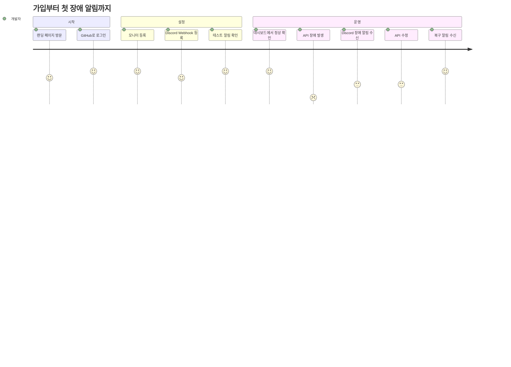

# 01. 요구사항 분석

> 상태: 확정 (2026-11-09).

## 1. 서비스 개요

개발자가 자신의 API URL을 등록하면 서버가 주기적으로 호출해 상태와 응답 시간을 기록하고, 장애와 복구를 감지해 알려 주는 서비스다.

| 항목 | 내용 |
| --- | --- |
| 대상 사용자 | 자신의 API를 운영하는 개인 개발자, 소규모 팀의 개발자 |
| 해결하는 문제 | 내 API가 죽은 사실을 사용자의 제보보다 먼저 알고 싶다 |
| 포트폴리오 목표 | 대량 스케줄링, SSRF 방어, 장애 판정, 시계열 데이터 처리를 실제 서비스 수준으로 구현한다 |

**SSRF**(Server-Side Request Forgery)는 공격자가 URL을 입력해 우리 서버가 내부망 주소를 대신 호출하게 만드는 공격이다. 이 서비스는 사용자가 입력한 URL을 호출하는 것이 핵심 기능이라 가장 중요한 위협이다.

## 2. 기능 요구사항

### 2.1 회원

| ID | 요구사항 | 이유 |
| --- | --- | --- |
| F-M1 | GitHub OAuth로 가입과 로그인을 한 번에 처리한다 | 사용자가 개발자이고, 비밀번호를 저장하지 않아도 된다 |
| F-M2 | 로그아웃하면 해당 기기의 Refresh Token을 무효화한다 | JWT만 쓰면 서버가 로그아웃을 강제할 수 없다 |
| F-M3 | 데모 버튼으로 샘플 데이터를 읽기 전용으로 체험한다 | 포트폴리오를 보는 사람이 GitHub 권한을 승인하지 않아도 된다 |
| F-M4 | 회원 탈퇴 시 모니터와 관련 데이터를 삭제한다 | 더 쓰지 않는 사용자의 URL을 계속 호출하면 안 된다 |

**OAuth**는 비밀번호를 우리에게 주지 않고 GitHub에게 "이 사람이 맞다"는 확인만 받는 로그인 방식이다. **JWT**는 서버가 서명해서 발급하는 출입증 형태의 토큰이다.

### 2.2 모니터 등록·관리

**모니터**는 검사할 API 하나에 대한 설정 묶음이다.

| ID | 요구사항 | 이유 |
| --- | --- | --- |
| F-W1 | 이름, URL, 메서드(GET/HEAD), 검사 주기, Timeout, 기대 상태 코드, 요청 헤더를 입력해 등록한다 | 인증이 필요한 API도 검사할 수 있어야 한다 |
| F-W2 | 조회, 수정, 삭제, 일시 정지, 재개를 지원한다 | 점검 중에는 잘못된 알림을 받지 않아야 한다 |
| F-W3 | 등록과 수정 시 URL의 SSRF 검증을 한다 | 위험한 URL은 저장 단계에서 거른다 |
| F-W4 | 사용자당 모니터는 20개까지 등록한다 | 서비스 악용과 비용 증가를 막는다 |
| F-W5 | 다른 사용자의 모니터에 접근하면 404로 응답한다 | 403이면 해당 모니터가 존재한다는 사실이 드러난다 |
| F-W6 | 조회 응답에서 요청 헤더 값은 가린다 | 사용자의 인증 토큰이 화면과 로그로 새지 않게 한다 |

### 2.3 주기 검사

| ID | 요구사항 | 이유 |
| --- | --- | --- |
| F-C1 | 짧은 주기의 디스패처가 `next_check_at`이 지난 모니터를 찾아 검사한다 | 모니터마다 타이머를 만들면 수가 늘수록 관리가 불가능하다 |
| F-C2 | 모든 검사 요청에 연결 시점의 SSRF 검증을 한다 | 등록 후 DNS가 내부 IP로 바뀌는 공격을 막는다 |
| F-C3 | 상태 코드, 응답 시간, 결과 종류를 저장한다 | 그래프와 장애 원인 표시의 재료다 |
| F-C4 | 응답 Body는 읽지 않고 버린다 | 고객 데이터를 보관하지 않고 메모리도 아낀다 |
| F-C5 | 첫 검사 시각을 무작위로 분산한다 | 모든 모니터가 같은 초에 몰리는 것을 막는다 |

**디스패처**는 "지금 실행할 일"을 찾아 작업을 나눠 주는 역할이다. **DNS**는 도메인 이름을 IP 주소로 바꾸는 시스템이다.

### 2.4 장애 감지

| ID | 요구사항 | 이유 |
| --- | --- | --- |
| F-I1 | 연속 3회 실패하면 장애로 판정한다 | 일시적인 네트워크 오류로 알림을 보내지 않는다 |
| F-I2 | 연속 2회 성공하면 복구로 판정한다 | 복구와 장애를 짧게 오가는 현상을 줄인다 |
| F-I3 | 장애의 시작 시각, 복구 시각, 지속 시간, 원인을 저장한다 | 이력 화면과 가동률 계산의 기준이다 |
| F-I4 | 모니터 하나에 진행 중인 장애는 하나만 존재한다 | 중복 실행이 일어나도 장애와 알림이 중복되지 않게 한다 |

실패의 종류는 다음과 같이 구분한다.

| 결과 | 의미 | 연속 실패에 포함 |
| --- | --- | --- |
| `SUCCESS` | 기대한 상태 코드 응답 | 아니요 |
| `TIMEOUT` | 제한 시간 초과 | 예 |
| `CONNECTION_ERROR` | 연결 거부, 연결 끊김 | 예 |
| `DNS_ERROR` | 도메인 조회 실패 | 예 |
| `TLS_ERROR` | HTTPS 인증서 오류 | 예 |
| `UNEXPECTED_STATUS` | 기대하지 않은 상태 코드 | 예 |
| `BLOCKED` | SSRF 검증에서 차단 | 아니요. 별도 상태로 처리 |

### 2.5 대시보드

| ID | 요구사항 | 이유 |
| --- | --- | --- |
| F-D1 | 전체 모니터 수, 정상 수, 장애 수, 최근 장애를 요약한다 | 접속하자마자 상태를 알 수 있어야 한다 |
| F-D2 | 모니터별 현재 상태, 마지막 검사 결과, 24시간 가동률을 보여 준다 | 어떤 API에 문제가 있는지 찾는다 |
| F-D3 | 응답 시간 그래프를 24시간, 7일, 30일로 보여 준다 | 성능 저하 추세를 본다 |
| F-D4 | 장애 이력을 지속 시간, 원인과 함께 보여 준다 | 장애 패턴을 돌아본다 |

### 2.6 알림

| ID | 요구사항 | 이유 |
| --- | --- | --- |
| F-N1 | Discord Webhook을 알림 채널로 등록하고 테스트 발송을 할 수 있다 | 설정이 맞는지 장애 전에 확인해야 한다 |
| F-N2 | 장애 시작과 복구 때 각 1번 알린다 | 같은 내용의 반복 알림은 금방 무시된다 |
| F-N3 | 발송 실패 시 간격을 늘려 가며 재시도한다 | Discord 일시 장애로 알림을 잃지 않는다 |
| F-N4 | 장애 기록과 발송 예약은 같은 트랜잭션으로 저장한다 | 서버가 중간에 죽어도 알림이 사라지지 않는다 |

**Webhook**은 정해진 URL로 메시지를 보내면 채널에 글이 올라가는 방식이다. **트랜잭션**은 여러 DB 작업을 전부 성공시키거나 전부 취소하는 단위다.

## 3. 비기능 요구사항

### 3.1 보안

| ID | 요구사항 |
| --- | --- |
| N-S1 | `http`, `https`만 허용한다. URL에 사용자 정보(`user:pass@`)가 있으면 거부한다 |
| N-S2 | DNS로 조회한 모든 IP를 검증하고, 검증한 IP로만 연결한다 |
| N-S3 | `CLAUDE.md`의 차단 대역을 모두 막는다 |
| N-S4 | Redirect는 따라가지 않는다 |
| N-S5 | 포트는 80, 443, 1024 이상만 허용한다. SMTP 등 잘 알려진 서비스 포트의 악용을 막는다 |
| N-S6 | Webhook URL은 `https://discord.com/api/webhooks/`로 시작하는 주소만 허용한다. 이 입력도 SSRF 경로가 될 수 있다 |
| N-S7 | 요청 헤더 값과 Webhook URL은 암호화해 저장하고 로그에 남기지 않는다 |
| N-S8 | `Host`, `Content-Length`, `Transfer-Encoding`, `Connection` 헤더는 사용자가 지정할 수 없다 |
| N-S9 | Refresh Token은 `HttpOnly` 쿠키로만 전달하고 DB에는 해시로 저장한다 |
| N-S10 | 재발급할 때마다 Refresh Token을 교체하고, 이미 쓴 토큰이 다시 오면 그 로그인 묶음을 전부 무효화한다 |

**DNS 리바인딩**은 검증할 때는 공인 IP를, 실제 연결할 때는 내부 IP를 돌려주어 검증을 우회하는 공격이다. N-S2가 이것을 막는다.

`CLAUDE.md`의 차단 목록에는 다음 대역도 포함한다. 모두 인터넷에서 정상적으로 쓰이지 않는 주소다.

| 추가 대역 | 용도 |
| --- | --- |
| `192.0.0.0/24`, `198.18.0.0/15`, `240.0.0.0/4`, `255.255.255.255` | IETF 예약, 벤치마크, 미래 예약, 브로드캐스트 |
| `64:ff9b::/96`, `2002::/16`, IPv4-compatible IPv6 | IPv6 안에 IPv4 내부 주소를 숨기는 변환 형식 |

### 3.2 성능

| ID | 목표 | 근거 |
| --- | --- | --- |
| N-P1 | 모니터 1,000개를 1분 주기로 처리한다 | 초당 약 17건 |
| N-P2 | 동시 검사 수는 200개로 제한한다 | 전부 10초 Timeout이어도 약 167개 동시 실행이라 여유가 있다 |
| N-P3 | 디스패치 지연 p95는 5초 이내다 | 예정 시각보다 늦게 실행되는 정도. p95는 100건 중 95번째로 느린 값이다 |
| N-P4 | 일반 API 응답 시간 p95는 300ms 이내다 | 대시보드 체감 속도 |

### 3.3 데이터 보관

1,000개를 1분마다 검사하면 원본 기록이 하루 144만 건 쌓인다.

| 데이터 | 보관 기간 | 이유 |
| --- | --- | --- |
| 검사 원본 | 14일 (결정 필요) | 원인 분석에는 최근 기록이면 충분하고, 저장 공간이 가장 많이 드는 데이터다 |
| 시간별 집계 | 365일 | 7일 이상 그래프와 가동률은 집계로 충분하다 |
| 장애 이력 | 모니터 삭제 전까지 | 건수가 적고 가치가 높다 |

### 3.4 가용성과 알려진 한계

서버 1대로 운영하므로 서버가 멈추면 검사도 멈춘다. 우리 서버의 네트워크가 끊기면 모든 모니터가 동시에 실패로 보일 수 있다. MVP에서는 한계로 문서화하고, 19단계 장애 시나리오에서 "전체 검사의 대부분이 동시에 실패하면 장애 판정을 보류"하는 보호 장치를 검토한다.

## 4. 사용자 시나리오: 가입부터 첫 장애 알림까지

1. 개발자가 랜딩 페이지에서 **GitHub로 시작하기**를 누른다.
2. GitHub에서 권한을 승인하면 회원이 자동 생성되고 대시보드로 이동한다.
3. **모니터 추가**에서 이름, URL, 1분 주기를 입력한다. 서버가 URL을 검증한다.
4. 알림 설정에서 Discord Webhook URL을 넣고 **테스트 발송**으로 메시지를 확인한다.
5. 수십 초 안에 첫 검사가 끝나고 대시보드에 `UP`과 응답 시간이 표시된다.
6. 개발자의 API가 500을 반환하기 시작하면 30초 간격으로 재검사가 이어진다.
7. 3번째 실패에서 장애가 생성되고 Discord에 장애 알림이 온다.
8. API를 고치면 연속 2회 성공 후 복구 처리되고 복구 알림에 장애 지속 시간이 표시된다.

## 5. MVP 범위

| 포함 | 제외 | 제외 이유 |
| --- | --- | --- |
| GitHub OAuth, 데모 로그인 | 다른 소셜 로그인, 팀 계정 | 핵심 기능과 관련이 적다. 설계는 추가를 막지 않는다 |
| GET, HEAD 검사 | POST 등 쓰기 요청 | 반복 호출하면 고객 데이터가 변경될 수 있다 |
| 상태 코드 기반 판정 | 응답 본문 키워드 검사 | Body를 읽지 않는다는 규칙과 충돌한다 |
| Discord 알림 | 이메일, Slack | 채널 인터페이스만 맞추면 나중에 추가할 수 있다 |
| 대시보드 | 외부 공개 상태 페이지 | 인증 없는 공개 범위 설계가 별도로 필요하다 |
| 서버 1대, 단일 지역 검사 | 다중 지역 교차 검증 | 서버와 비용이 늘어난다 |
| 무료 사용 제한 | 요금제, 결제 | 포트폴리오 범위를 넘는다 |

## 6. 도메인 규칙 검토

`CLAUDE.md`의 기본값을 검토한 결과다.

| 항목 | 현재 값 | 제안 | 이유 |
| --- | --- | --- | --- |
| 검사 주기 | 1, 5, 10, 30, 60분 | 유지 | 선택지를 제한하면 부하를 예측하기 쉽다 |
| Timeout | 기본 10초, 최대 30초 | 유지, 최소 1초 추가 | 0초 같은 잘못된 값을 막는다 |
| 장애 판정 | 3회 연속 실패 | 유지 | 일시 오류와 실제 장애를 구분하는 균형점이다 |
| 복구 판정 | 2회 연속 성공 | 유지 | 위와 같다 |
| **실패 시 재검사** | 없음 | **판정이 끝나기 전에는 30초 뒤 재검사** | 60분 주기면 3회 실패까지 2시간이 걸린다. 재검사를 하면 어떤 주기든 약 1분 안에 판정한다 |
| **장애 중 검사 주기** | 설정 주기 유지 | **최대 5분으로 단축** | 60분 주기면 복구를 최대 1시간 늦게 안다 |
| **기대 상태 코드** | 2xx 고정 | **기본 2xx, 코드 5개까지 직접 지정** | Redirect를 따라가지 않으므로 301을 돌려주는 정상 API가 항상 실패로 기록된다 |
| **SSRF 차단** | 정의 없음 | **`BLOCKED` 상태로 분리** | 고객 API 장애가 아니므로 장애 알림을 보내면 안 된다 |
| 응답 Body | 저장 안 함 | 읽지 않고 즉시 버림 | 상태 코드만 필요하므로 최대 크기 처리도 단순해진다 |
| 응답 시간 | 정의 없음 | 요청 시작부터 응답 헤더 수신까지 | Body를 읽지 않으므로 기준을 명확히 한다 |
| 모니터 개수 | 20개 | 유지 | 한 사용자가 최대 분당 20건을 호출한다 |

제안을 적용했을 때의 상태 변화는 [아키텍처 문서](./02-architecture.md#42-모니터-상태-변화)에 있다.

## 7. 로드맵 검토 제안

아래 제안은 2026-11-09에 승인되어 `docs/PROGRESS.md`에 반영했다.

| 단계 | 제안 | 이유 |
| --- | --- | --- |
| 6 | Flyway와 첫 스키마 추가 | 처음부터 DB 변경 이력을 관리해야 한다 |
| 12 | 파티션 관리와 원본 삭제 작업 추가 | 검사 결과가 쌓이기 시작하는 시점에 필요하다 |
| 14 | 시간별 집계 작업, 데모 시드 데이터 추가 | 그래프와 체험 화면에 필요하다 |
| 16 뒤 | **부하 테스트 단계 신설** | Redis, Kafka의 필요 여부는 측정 결과로 판단해야 한다. 도구는 k6를 쓴다 |
| 20 | Caddy 구성 추가 | HTTPS와 프론트엔드 제공에 필요하다 |

## 8. 결정 필요

> 결정 (2026-11-09): D3은 해당 항목의 결정대로 하고, 나머지는 굵게 표시한 추천안을 채택했다.

### D1. Access Token 저장 위치

| 선택지 | 장점 | 단점 |
| --- | --- | --- |
| **브라우저 메모리** | XSS로 토큰을 오래 훔치기 어렵다 | 새로고침마다 재발급 요청이 필요하다 |
| `localStorage` | 구현이 쉽다 | XSS 한 번으로 토큰이 유출된다 |

**XSS**는 악성 스크립트가 페이지 안에서 실행되는 공격이다.

### D2. 로그아웃 범위

| 선택지 | 장점 | 단점 |
| --- | --- | --- |
| **현재 기기만 + "모든 기기 로그아웃" 버튼** | 일반적인 사용 경험이고, 계정 탈취에도 대응한다 | API가 하나 늘어난다 |
| 현재 기기만 | 가장 단순하다 | 다른 기기의 로그인을 끊을 수 없다 |
| 항상 전체 기기 | 안전하다 | 다른 기기까지 매번 로그아웃된다 |

### D3. JWT 구현 방식

> 결정 (2026-11-09): `jjwt` + 직접 만든 Spring Security 필터. SmartFridge의 `JwtTokenFilter`, `JwtTokenProvider`, 401·403 핸들러 구조를 잇는다. 구체적인 구조는 [아키텍처 문서](./02-architecture.md#21-요청-인증)에 있다.

| 선택지 | 장점 | 단점 |
| --- | --- | --- |
| Spring Security OAuth2 Resource Server | 검증 필터를 직접 만들지 않아 보안 실수가 줄어든다 | 처음 쓰는 설정을 익혀야 한다 |
| **`jjwt` + 직접 만든 필터 (선택)** | SmartFridge에서 써 본 방식이다 | 필터를 직접 작성하고 테스트해야 한다 |

### D4. 토큰 수명

| 선택지 | 장점 | 단점 |
| --- | --- | --- |
| **Access 15분, Refresh 14일** | 탈취 피해 시간과 재로그인 빈도의 균형이 좋다 | 없음 |
| Access 1시간, Refresh 30일 | 재발급 요청이 적다 | 탈취되었을 때 피해 시간이 길다 |

### D5. 알림 채널

| 선택지 | 장점 | 단점 |
| --- | --- | --- |
| **Discord만** | 구현이 가장 빠르고 로드맵과 일치한다 | Discord를 쓰지 않는 사용자는 알림을 못 받는다 |
| Discord + Slack | Webhook 방식이 비슷해 추가 비용이 작다 | 메시지 형식과 테스트가 늘어난다 |
| Discord + 이메일 | 사용자 범위가 가장 넓다 | 발송 서비스, 도메인 설정이 필요하다 |

### D6. 장기 장애 재알림

| 선택지 | 장점 | 단점 |
| --- | --- | --- |
| **재알림 없음** | 구현이 단순하고 알림 피로가 없다 | 첫 알림을 놓치면 복구 때까지 모른다 |
| 1시간마다 재알림 | 놓칠 위험이 줄어든다 | 재알림 기록과 중복 방지 설계가 복잡해진다 |

### D7. 검사 원본 보관 기간

| 선택지 | 장점 | 단점 |
| --- | --- | --- |
| **14일** | 약 2천만 행(목표 규모). 작은 서버에서 현실적이다 | 2주가 지난 건은 건별 원인을 볼 수 없다 |
| 7일 | 저장 공간이 가장 적다 | 지난주 문제를 분석하기에 빠듯하다 |
| 30일 | 분석 범위가 넓다 | 약 4,300만 행으로 디스크와 메모리 부담이 크다 |

### D8. 도메인 규칙 변경안

| 선택지 | 장점 | 단점 |
| --- | --- | --- |
| **6장의 제안을 모두 적용** | 장애를 빨리 감지하고 오탐이 줄어든다 | 상태 처리 규칙이 조금 늘어난다 |
| 재검사만 빼고 적용 | 호출 횟수가 가장 예측하기 쉽다 | 긴 주기에서 장애 감지가 수 시간 늦어진다 |

### D9. Redirect 처리

| 선택지 | 장점 | 단점 |
| --- | --- | --- |
| **따라가지 않고 기대 상태 코드로 판정** | SSRF 위험이 없고 동작이 단순하다 | 최종 목적지의 상태는 확인하지 못한다 |
| 최대 3회 따라가며 매번 검증 | 최종 목적지까지 확인한다 | 구현과 테스트가 복잡하고, 우회 경로가 늘어난다 |

