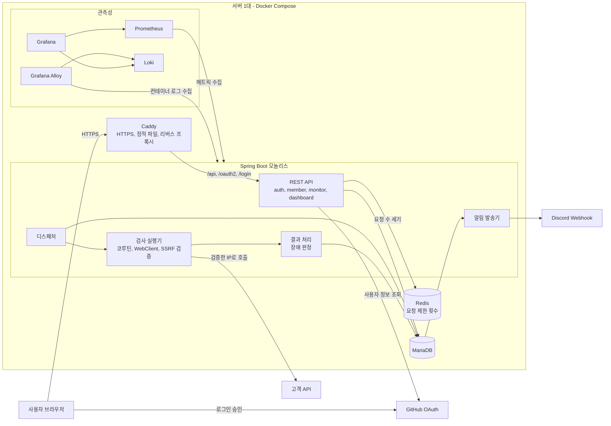
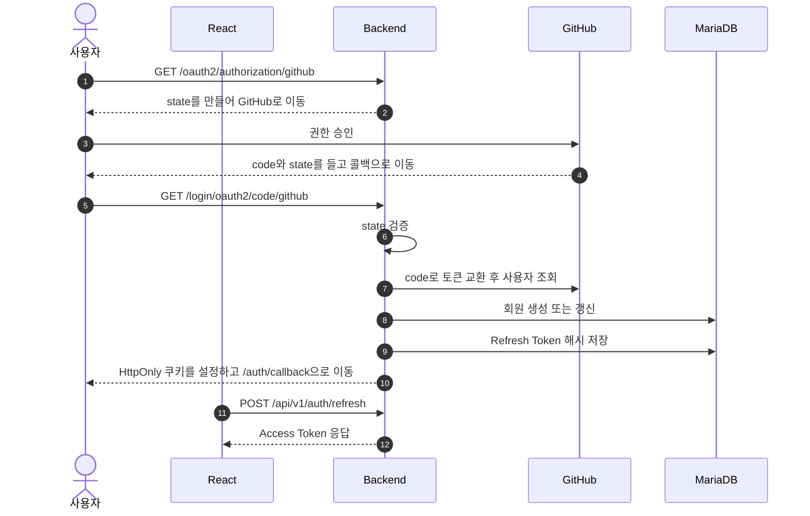
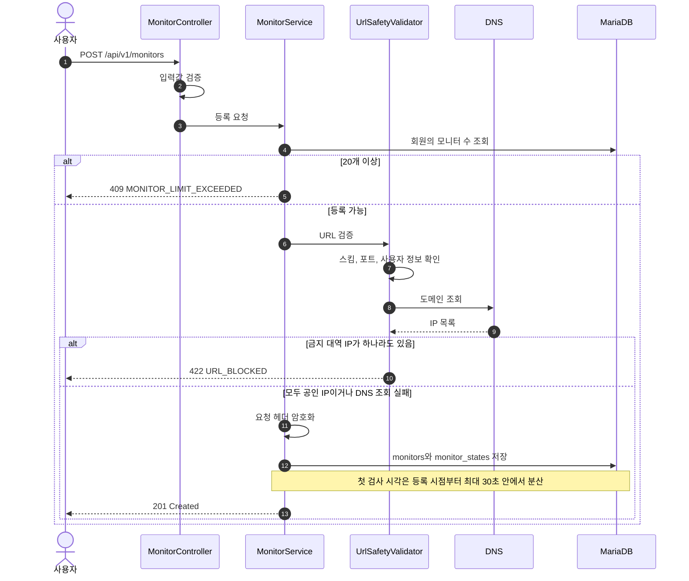
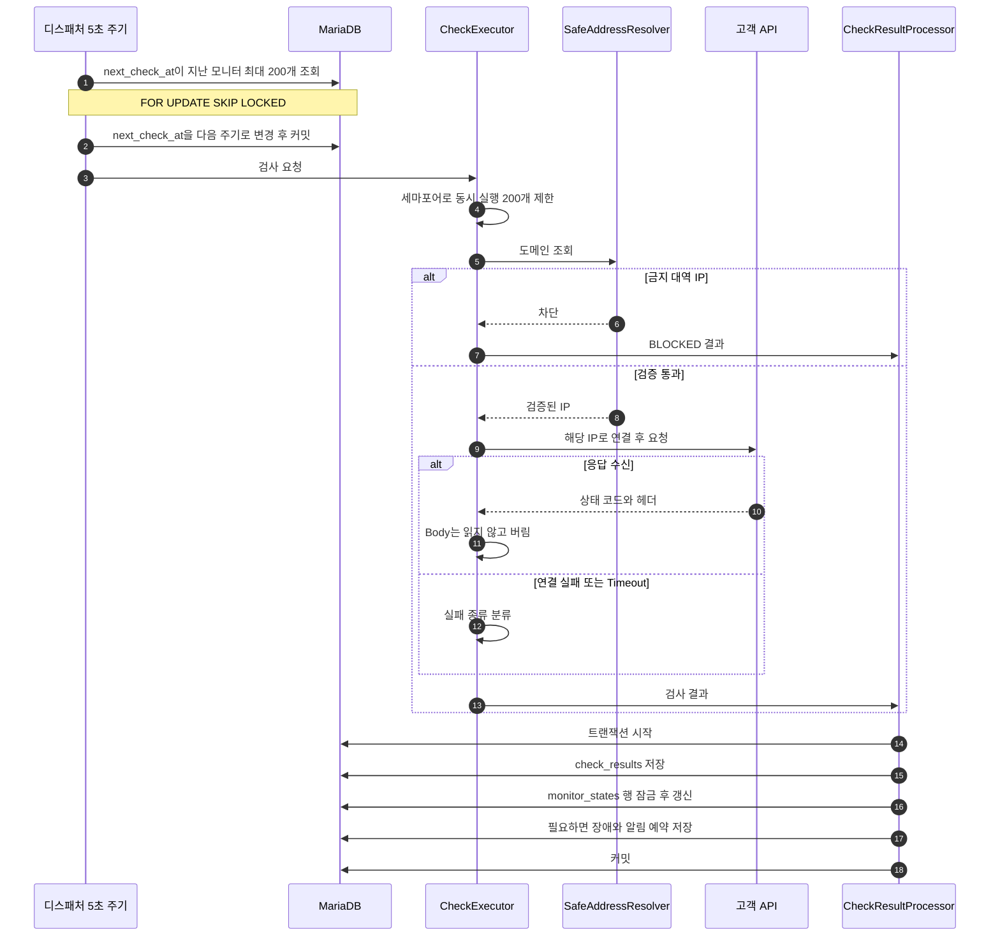
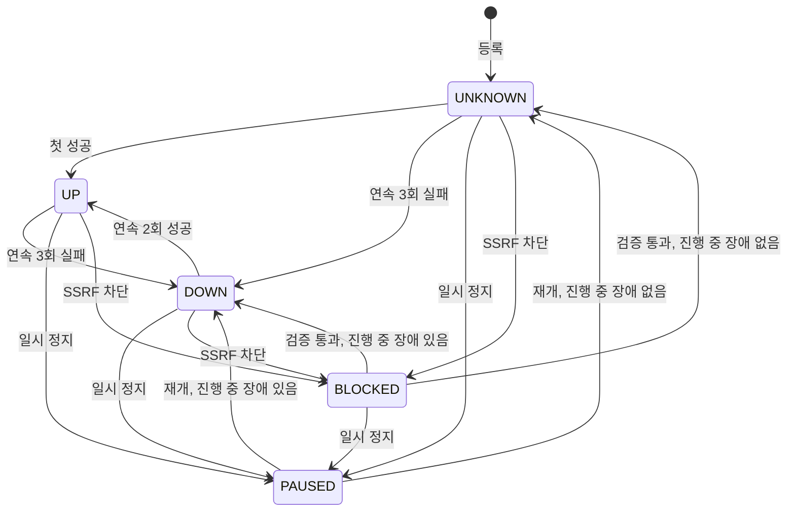
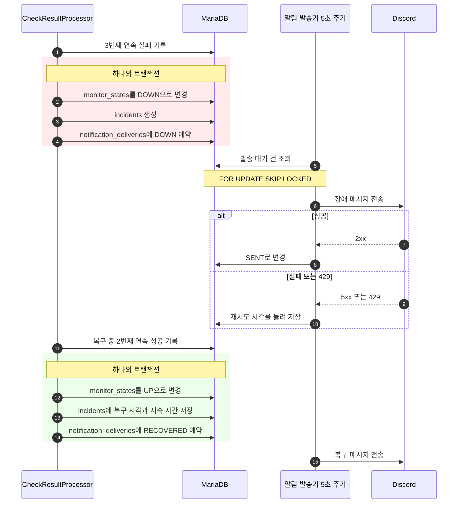
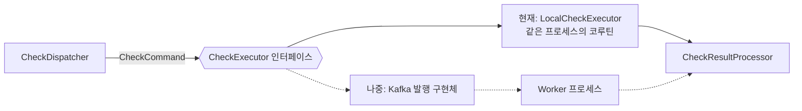

# 02. 시스템 아키텍처

> 상태: 확정 (2026-11-09).

## 1. 전체 구성도



| 구성 요소 | 역할 | 선택 이유 |
| --- | --- | --- |
| Caddy | HTTPS 인증서 자동 발급, React 정적 파일 제공, API 전달 | 화면과 API를 같은 도메인으로 묶어 CORS 설정과 쿠키 처리가 단순해진다 |
| Spring Boot | API, 스케줄링, 검사, 알림을 한 프로세스에서 실행 | 처음부터 나누면 배포와 장애 지점만 늘어난다 |
| MariaDB | 회원, 설정, 검사 기록, 장애, 알림 예약 저장 | `SKIP LOCKED`를 지원하며(10.6 이상), 날짜별 파티션으로 오래된 기록을 빠르게 지울 수 있다 |
| Redis | 요청 제한 횟수 (17단계) | 서버가 여러 대여도 횟수를 한곳에서 세고, 키마다 만료 시간을 둘 수 있다. 장애가 나도 요청은 통과시킨다 (6.1절) |
| Prometheus, Grafana | 우리 서버 자체의 메트릭 수집과 시각화 | 고객 API 검사 이력과 섞지 않는다 |
| Alloy, Loki | 컨테이너 로그 수집과 검색 | 로그 수집은 `CLAUDE.md` 규칙에 따라 Alloy로 한다 |

**리버스 프록시**는 외부 요청을 먼저 받아 내부 서버로 전달하는 서버다. **CORS**는 다른 도메인의 페이지가 API를 호출할 때 브라우저가 적용하는 제한이다. **메트릭**은 요청 수, 메모리 사용량 같은 수치 데이터다.

`/actuator`는 Caddy를 통해 외부에 노출하지 않고 컨테이너 내부 네트워크에서만 접근한다. 이를 위해 Actuator는 앱 포트(8080)와 다른 관리 포트(8081)에서만 열고, `health`, `info`, `prometheus` 세 엔드포인트만 노출한다.

### 1.1 서버 메트릭 (15단계에서 확정)

Spring Boot가 자동으로 모으는 API 요청(`http_server_requests`), JVM, DB 연결 풀(`hikaricp`) 메트릭에 더해 아래 메트릭을 직접 기록한다. 모두 우리 서버의 처리 현황이며, 모니터 ID나 고객 URL은 태그에 넣지 않는다. 고객 검사 이력과 섞지 않고, 모니터 수에 따라 메트릭 종류가 끝없이 늘어나는 것도 막기 위해서다.

| 메트릭 | 종류 | 쓰임 |
| --- | --- | --- |
| `apimonitor.check.dispatch.delay` | 타이머(히스토그램) | 예정 시각부터 디스패처가 가져갈 때까지. N-P3 p95 5초 확인 |
| `apimonitor.check.executions` (`result`) | 카운터 | 결과 종류별 검사 수. N-P1 처리량 확인 |
| `apimonitor.check.duration` | 타이머(히스토그램) | 검사 한 번에 걸린 시간 |
| `apimonitor.check.in_flight` | 게이지 | 실행 중인 검사 수. N-P2 한도 200 대비 |
| `apimonitor.check.result_save_failures` | 카운터 | 3번 시도해도 저장하지 못한 검사 결과 수 (DB 장애 신호) |
| `apimonitor.notification.deliveries` (`outcome`) | 카운터 | 알림 발송 결과: sent, retry, failed |
| `apimonitor.scheduled.job.failures` (`task`) | 카운터 | 디스패처, 발송기, 파티션, 집계, 데모 데이터 작업의 실패 수 |

API 응답 시간과 디스패치 지연은 Prometheus가 p95를 계산할 수 있게 히스토그램으로 내보낸다. 고객 API를 호출하는 WebClient는 직접 만들어 쓰므로 호출 URL별 자동 메트릭이 붙지 않는다. 개발용 Prometheus·Grafana 설정은 `infra/`에 있고, Grafana 대시보드는 시작할 때 자동으로 등록된다.

### 1.2 서버 로그 (16단계에서 확정)

서버 로그는 Alloy가 모아 Loki에 저장하고 Grafana에서 검색한다.

```
Spring Boot ──JSON 로그──▶ Alloy ──▶ Loki ◀── Grafana
```

| 항목 | 결정 | 이유 |
| --- | --- | --- |
| 형식 | 파일 로그는 한 줄에 JSON 하나(Spring Boot 내장 `logstash` 형식). 터미널 로그는 기본 형식 유지 | 레벨, 로거, traceId를 필드로 정확히 찾는다. 라이브러리를 추가하지 않는다 |
| 수집 (개발) | 앱이 `backend/logs/api-monitor.log`에 쓰고, Alloy 컨테이너가 그 폴더를 읽기 전용으로 읽는다 | 개발 중 앱은 컨테이너가 아니라 PC에서 실행된다. 운영은 20단계에서 컨테이너 로그 수집으로 바꾼다 |
| 라벨 | `app`, `level`만 | 라벨은 로그 묶음을 나누는 기준이라 값 종류가 많으면 Loki가 느려진다 |
| 구조화 메타데이터 | `traceId`, `logger` | 요청마다 값이 달라 라벨 대신 검색 가능한 부가 정보로 넣는다 |
| 보관 | 개발 7일. 로그 파일은 10MB마다 나누고 7일 보관 | 운영 보관 기간은 20단계에서 정한다 |

**traceId**: 요청이 들어오면 `TraceIdFilter`가 16자리 ID를 만들어 MDC(로그마다 자동으로 붙는 값 저장소)에 넣는다. 보안 필터보다 먼저 실행되므로 그 요청의 모든 로그와 오류 응답(401·403 포함)의 `traceId`가 같다. 클라이언트가 보낸 값은 쓰지 않는다. 주기 작업(검사, 알림 발송)의 로그에는 traceId가 없고 모니터 ID로 찾는다.

**남기지 않는 값**: 고객 URL, 요청 헤더 값, Webhook 주소, 토큰. 로그 수집 경로를 추가해도 이 규칙은 앱에서 지킨다.

Grafana의 "API Monitor 서버" 대시보드 아래쪽에 최근 오류·경고 로그와 traceId 검색 패널이 있다.

## 2. 로그인 흐름

OAuth로 사용자를 확인한 뒤의 로그인 유지는 우리 서비스가 맡는다.



왜 이렇게 했는가

- **Access Token을 URL에 담지 않는다.** URL은 브라우저 기록과 서버 로그에 남는다.
- **`state`를 검증한다.** 공격자의 로그인 결과를 피해자 브라우저에 끼워 넣는 CSRF 공격을 막는다.
- **GitHub 토큰은 저장하지 않는다.** 사용자 확인에만 필요하며, 보관하면 유출 위험만 늘어난다.
- **Refresh Token은 JWT가 아닌 무작위 문자열로 만든다.** 어차피 DB에서 조회해야 하므로 서명이 필요 없다.
- **보안 설정은 두 갈래로 나눈다.** OAuth 진행 구간만 세션을 잠깐 쓰고, 일반 API는 Stateless로 처리한다. 서버를 여러 대로 늘리면 세션 공유가 필요하며, 이것이 Redis를 도입할 이유 중 하나다.

### 2.1 요청 인증

SmartFridge의 구조를 따른다. `JwtTokenProvider`가 Access Token을 만들고, `JwtTokenFilter`가 요청마다 검증해 `SecurityContext`에 사용자를 넣는다.

| 구성 요소 | 역할 |
| --- | --- |
| `JwtTokenProvider` | HS256으로 Access Token 서명. `subject`는 회원 ID, `role`은 `USER` 또는 `DEMO` |
| `JwtTokenFilter` | `UsernamePasswordAuthenticationFilter` 앞에서 Bearer 토큰을 검증하고 권한을 `ROLE_` 형식으로 설정 |
| `JwtAuthenticationHandler` | 인증 실패 시 401 응답 |
| `JwtAuthorizationHandler` | 권한 부족 시 403 응답. 데모 계정의 변경 요청은 `DEMO_READ_ONLY` |

`SecurityContext`는 현재 요청의 사용자 정보를 담아 두는 Spring Security의 저장 공간이다.

SmartFridge에서 다음을 보완한다.

| 보완 | 이유 |
| --- | --- |
| `OncePerRequestFilter`를 상속하고, 서블릿 필터로 자동 등록되지 않게 한다 | `@Component`인 필터는 Spring Boot가 일반 필터로도 등록해 한 요청에서 두 번 실행될 수 있다 |
| 토큰 오류의 종류를 요청 속성에 담아 401 핸들러로 전달한다 | 예외를 로그만 남기고 넘기면 만료(`AUTH_TOKEN_EXPIRED`)와 위조(`AUTH_TOKEN_INVALID`)를 구분할 수 없어 프론트엔드가 재발급 여부를 판단하지 못한다 |
| `Bearer ` 접두사를 확인한 뒤 토큰을 자른다 | 잘못된 헤더 형식을 정상 경로에서 거른다 |
| `subject`를 이메일 대신 회원 ID로 쓴다 | 이메일을 수집하지 않고, 변하지 않는 값이어야 한다 |
| 최신 `jjwt` API를 쓰고 서명 키를 공유한다 | 발급과 검증이 같은 키와 알고리즘을 쓰게 한다 |
| 만료된 토큰은 `error`가 아닌 낮은 로그 레벨로 남긴다 | 정상적으로 자주 일어나는 일이라 실제 오류가 묻힌다 |

CORS는 설정하지 않는다. 운영에서는 Caddy가 화면과 API를 같은 도메인으로 묶고, 개발 환경은 Vite 프록시를 쓴다.

### 2.2 Refresh Token 쿠키

Synco의 `CookieUtil` 구조를 따른다. 쿠키 생성과 삭제를 한 클래스에 모으고, 환경마다 달라지는 값은 설정으로 분리한다.

| 메서드 또는 설정 | 역할 |
| --- | --- |
| `createRefreshTokenCookie` | `ResponseCookie`로 `HttpOnly` 쿠키 생성 |
| `deleteRefreshTokenCookie` | 같은 속성에 `Max-Age=0`으로 쿠키 삭제 |
| `cookie.secure` | 로컬 `false`, 운영 `true` |
| `cookie.same-site` | `Lax` |
| `cookie.max-age` | Refresh Token 수명과 같은 14일 |

| 사용 위치 | 동작 |
| --- | --- |
| GitHub 로그인 성공 | 쿠키 설정 후 `/auth/callback`으로 이동 |
| `POST /api/v1/auth/refresh` | 교체된 새 토큰으로 쿠키 재설정 |
| `POST /api/v1/auth/logout` | 쿠키 삭제 |

Synco에서 다음을 바꾼다.

| 보완 | 이유 |
| --- | --- |
| `Path`를 `/`에서 `/api/v1/auth`로 제한 | 일반 API 요청에 Refresh Token이 함께 전송되지 않는다 |
| 재발급할 때도 쿠키를 다시 설정 | Refresh Token을 매번 교체하므로 브라우저의 값도 바뀌어야 한다 |

쿠키를 삭제할 때는 생성할 때와 `Path`가 같아야 브라우저가 지운다. 두 메서드가 같은 값을 쓰도록 경로를 상수로 둔다.

### 2.3 재발급 동시 요청 처리

| 상황 | 처리 |
| --- | --- |
| 한 탭에서 여러 요청이 동시에 만료 | Frontend가 재발급 요청을 하나로 묶어 한 번만 보낸다 |
| 같은 Refresh Token으로 동시에 재발급 | 토큰 행을 비관적 잠금으로 조회해 한 요청만 교체에 성공한다 |
| 여러 탭이 동시에 재발급 | 늦은 탭은 10초 유예 규칙에 따라 거절된다. 그사이 쿠키가 새 토큰으로 바뀌었으므로 Frontend가 한 번 더 재발급을 시도한다 |
| 10초가 지난 뒤 이미 쓴 토큰이 다시 옴 | 탈취로 보고 같은 묶음의 토큰을 모두 무효화한다 |

**비관적 잠금**은 조회하는 순간 행을 잠가, 트랜잭션이 끝날 때까지 다른 트랜잭션이 같은 행을 바꾸지 못하게 하는 방식이다.

### 2.4 OAuth 로그인 처리

- GitHub에서 받는 사용자 정보의 범위(scope)는 `read:user`다. 이메일은 받지 않는다.
- OAuth 진행 중의 `state` 보관에만 세션을 쓰고, 로그인 성공 후 세션을 무효화한다. 인증 정보는 세션에 저장하지 않는다.
- 성공하면 Refresh Token 쿠키를 설정하고 `/auth/callback`으로, 실패하면 `/?loginError=true`로 이동한다.

## 3. 모니터 등록과 URL 검증



왜 이렇게 했는가

- **IP가 하나라도 금지 대역이면 거부한다.** 공인 IP와 내부 IP를 섞어 돌려주는 우회를 막는다.
- **DNS 조회 실패는 등록을 허용한다.** 아직 배포 전이거나 일시 장애일 수 있고, 위험한 주소라는 근거가 없다. 실패는 검사 결과로 드러난다.
- **등록할 때만 검증하지 않는다.** DNS 응답은 언제든 바뀔 수 있으므로 검사 때마다 다시 검증한다.

## 4. 주기 검사와 장애 처리

### 4.1 검사 실행부터 결과 저장까지



왜 이렇게 했는가

- **실행 전에 `next_check_at`을 먼저 옮긴다.** 검사 중 서버가 죽어도 "실행 중" 표시가 남지 않는다. 그 회차는 건너뛰고 다음 주기에 정상 재개된다.
- **`SKIP LOCKED`를 처음부터 쓴다.** 다른 프로세스가 잠근 행을 건너뛰는 기능이다. 지금은 서버가 1대지만 비용이 거의 없고, 여러 대로 늘려도 같은 모니터를 중복 검사하지 않는다.
- **결과 처리는 모니터당 한 트랜잭션이다.** 기록, 상태, 장애, 알림 예약이 함께 저장되거나 함께 취소된다. 초당 약 17건이면 묶음 저장 없이도 충분하다.
- **코루틴과 JPA를 분리한다.** 네트워크 대기는 코루틴으로 처리하고, DB 저장은 제한된 스레드 풀로 넘긴다. JPA 트랜잭션은 스레드에 묶여 동작해 코루틴과 섞으면 찾기 어려운 버그가 생긴다.

**코루틴**은 적은 스레드로 많은 대기 작업을 처리하는 Kotlin 기능이다. **세마포어**는 동시에 실행할 수 있는 개수를 제한하는 장치다.

검사 요청의 세부 동작 (11단계에서 확정)

- **연결 시점 IP 검증은 WebClient의 주소 변환 단계에 끼워 넣는다.** Reactor Netty(WebClient의 통신 엔진)가 도메인을 IP로 바꿀 때 `SafeAddressResolver`를 쓰게 했다. 조회한 IP가 하나라도 차단 대역이면 연결하지 않고, 통과한 IP로만 연결한다. Host 헤더와 인증서 확인은 원래 도메인으로 하므로 정상 사이트는 그대로 동작한다. URL에 IP를 직접 쓰면 이 단계를 거치지 않으므로 요청 전에 따로 검사한다.
- **부하 테스트에서만 정해 둔 주소 하나를 허용한다 (16-1단계).** 부하 테스트는 PC에 띄운 가짜 대상 서버(`127.0.0.1`)를 검사해야 하는데, 이 주소는 차단 대역이다. `loadtest`와 `local` 프로필이 **함께** 켜졌을 때만 설정에 적은 IP(`loadtest.allowed-addresses`)를 차단 규칙에서 빼고, 나머지 차단 대역은 그대로 막는다. 운영 프로필에서는 이 설정이 아예 만들어지지 않는다. 모니터 등록 API의 검증에는 적용하지 않으므로 사용자가 이 주소를 등록할 수는 없고, 부하 테스트용 모니터는 SQL로 넣는다.
- **연결을 재사용하지 않는다.** 매번 새로 연결해야 DNS 조회와 IP 검증이 매번 일어나고, 응답 시간도 같은 조건으로 잰다.
- **응답 본문은 읽지 않고 연결을 닫는다.** WebClient의 `exchangeToMono`는 처리가 끝난 뒤 남은 본문을 끝까지 읽기 때문에, 본문이 느린 API를 `TIMEOUT`으로 잘못 판정했다. `exchangeToFlux`로 상태 코드만 받고 바로 구독을 취소해 본문을 읽지 않고 연결을 닫는다.
- **디스패처는 실행기의 빈자리만큼만 선점한다.** 가져와 놓고 세마포어를 오래 기다리면 검사가 예정보다 늦어지기 때문이다.
- **고객 API의 연결 오류는 로그에 스택 트레이스를 남기지 않는다.** 인증서 오류 등은 정상적인 검사 결과이므로, Reactor Netty의 연결 오류 WARN 로그를 끈다. 우리 로그에는 모니터 ID와 결과 종류만 남기고 URL과 헤더는 남기지 않는다.

### 4.2 모니터 상태 변화



| 상황 | 다음 검사 시각 |
| --- | --- |
| 정상 (`UP`, 연속 실패 0회) | 설정 주기 뒤 |
| 판정 중 (연속 실패 1~2회, 또는 장애 중 연속 성공 1회) | 30초 뒤 |
| 장애 중 (`DOWN`, 계속 실패) | 설정 주기와 5분 중 짧은 쪽 |
| `PAUSED` | `next_check_at`을 비워 조회에서 제외 |
| `BLOCKED` | 설정 주기 뒤 재검증 |

- 재검사 예약은 검사가 끝난 뒤에 하므로, 같은 모니터의 검사가 겹치지 않는다. 1회차 실행 시점에 `next_check_at`이 최소 1분 뒤로 옮겨지고, Timeout 최대값은 30초이기 때문이다.
- 일시 정지 중에도 진행 중인 장애는 닫지 않는다. 재개하면 `DOWN`으로 돌아가고, 연속 2회 성공해야 닫는다.
- `BLOCKED`가 되어도 진행 중인 장애는 유지한다. 연속 카운터는 0으로 되돌리고, `BLOCKED` 기록은 가동률 계산에서 제외한다.

판정 세부 규칙 (12단계에서 확정)

- **복구 시각은 연속 성공 2회 중 첫 성공 시각이다.** 장애 시작 시각(첫 실패)과 같은 기준이라 지속 시간이 판정에 걸린 시간만큼 늘어나지 않는다.
- **같은 결과가 두 번 오거나, 이미 반영한 결과보다 오래된 결과가 늦게 오면 상태를 바꾸지 않는다.** 원본 기록은 `INSERT IGNORE`로 한 번만 저장하고, 상태는 `last_checked_at`보다 나중 결과만 반영한다. 저장 재시도와 나중의 Kafka 중복 전달에 대비한 것이다.
- **판정 규칙은 `MonitorState` 엔티티의 메서드에 둔다.** DB 없이 단위 테스트로 표의 모든 경우를 확인한다.
- **알려진 한계:** 검사가 도는 도중 사용자가 URL을 바꾸면 옛 URL의 결과가 한 번 반영될 수 있다. 장애 판정에는 3회 연속 실패가 필요하고 다음 검사부터 바로잡히므로 영향이 작아 따로 막지 않는다.

### 4.3 장애 판정부터 알림 발송, 복구까지



왜 이렇게 했는가

- **Outbox 패턴을 쓴다.** 장애 저장과 알림 발송을 함께 처리할 수는 없다. 그래서 "보낼 알림"을 장애와 같은 트랜잭션으로 DB에 적고, 발송기가 따로 보낸다. 서버가 죽어도 재시작 후 이어서 보낸다.
- **중복 방지를 DB 제약으로 건다.** 애플리케이션 코드에 버그가 있어도 진행 중 장애는 모니터당 하나, 알림 예약은 장애·채널·종류별로 하나만 생긴다.
- **재시도는 최대 5회로 제한한다.** 1분, 5분, 15분, 1시간 등으로 간격을 늘린다. 429 응답(요청 과다)이면 Discord가 알려 준 대기 시간을 지킨다.

알림 전송 후 DB 기록 전에 서버가 죽으면 같은 알림이 다시 발송될 수 있다. 알림을 잃는 것보다 드문 중복이 낫다고 판단했다.

## 5. Worker 분리와 Kafka 도입을 쉽게 하는 구조

현재는 하나의 프로세스지만 경계는 미리 나눈다.



| 원칙 | 효과 |
| --- | --- |
| `check`는 `monitor`의 JPA 엔티티를 직접 받지 않고, 필요한 값만 담은 `CheckCommand`를 받는다 | 네트워크로 전달할 수 있는 형태가 된다 |
| 검사 결과도 `CheckResult` 값 객체로 전달한다 | 결과 처리가 실행 위치를 몰라도 된다 |
| 호출부는 `CheckExecutor` 인터페이스에만 의존한다 | 구현체만 바꾸면 Worker로 이동한다 |
| 결과 처리는 같은 입력이 두 번 와도 안전하게 만든다 | Kafka의 중복 전달에 대비한다 |
| `monitors`(설정)와 `monitor_states`(실행 상태)를 나눈다 | 사용자의 설정 수정과 검사 상태 갱신이 서로 충돌하지 않는다 |

확장 지점은 이 인터페이스 하나만 둔다. 미리 Kafka 추상화를 여러 겹 만들지 않는다.

## 6. Redis와 Kafka 도입 기준

Redis는 16단계 뒤 부하 테스트 결과를 기준으로 해결할 문제를 정해 도입한다. Kafka는 배포 후에 Worker 분리를 학습하고 검증하는 목적으로 도입한다.

| 기술 | 도입 시점 | 해결할 문제 | 도입하지 않는 경우 |
| --- | --- | --- | --- |
| Redis | 17단계 | 대시보드 반복 조회의 DB 부하, IP별 요청 제한, 서버 증설 시 OAuth 세션 공유 | 위 문제가 측정되지 않으면 요청 제한부터 최소 범위로 적용 |
| Kafka | 18단계, 배포 후 | 검사 작업을 Worker 프로세스로 분리하고, 트래픽 급증을 완충하는 구조를 검증 | 목표 규모에서 필요하지 않아도 학습·포트폴리오 목적으로 진행한다 |

16-1단계 측정 결과, 목표 규모에서 대시보드 API p95는 45ms로 캐시가 필요하지 않았다. 그래서 Redis는 요청 제한부터 최소 범위로 적용한다. 자세한 수치는 [부하 테스트](07-load-test.md)에 있다.

### 6.1 요청 제한 (17단계)

**요청 제한(rate limit)**은 같은 대상이 정해진 시간에 보낼 수 있는 요청 수에 상한을 두고, 넘으면 `429 RATE_LIMITED`로 거절하는 기능이다. 공개 서비스라 데모 로그인 반복 호출(토큰 발급과 DB 쓰기)이나 알림 테스트 발송 반복(Discord가 우리 서버 IP를 막을 수 있다) 같은 남용을 막는다. 횟수를 앱 메모리에 세면 서버가 늘어날 때 서버마다 따로 세므로 Redis에 센다.

| 규칙 | 대상 요청 | 기준 | 한도 |
| --- | --- | --- | --- |
| `demo-login` | `POST /api/v1/auth/demo` | IP | 분당 10 |
| `oauth-login` | `GET /oauth2/authorization/**` | IP | 분당 10 |
| `token-refresh` | `POST /api/v1/auth/refresh` | IP | 분당 30 |
| `notification-test` | `POST /api/v1/notification-channels/{id}/test` | 회원 | 분당 5 |
| `api` | 그 밖의 `/api/**` | 회원, 데모 계정과 비로그인은 IP | 분당 300 |

- 한 요청에는 규칙 하나만 적용한다. 위 표에서 먼저 맞는 규칙을 쓴다.
- **데모 계정은 IP로 센다.** 데모 방문자는 모두 같은 회원 하나를 쓰므로, 회원 기준이면 한 사람의 남용이 다른 방문자까지 막는다.
- **IP는 `request.remoteAddr`로 읽고 클라이언트가 보낸 `X-Forwarded-For`는 믿지 않는다.** 위조로 제한을 피할 수 있기 때문이다. 운영에서 Caddy가 넘겨 주는 실제 IP를 읽는 설정은 20단계에서 Caddy와 함께 한다.
- **세는 방식은 고정 창(fixed window)이다.** 키 `rl:{규칙}:{대상}:{분 번호}`를 `INCR`로 올리고, 첫 요청이면 60초 뒤 사라지게 `EXPIRE`를 건다. 두 명령은 Lua 스크립트 하나로 실행해 만료 없이 남는 키가 생기지 않게 한다. 분 경계에서 잠깐 한도의 2배까지 허용될 수 있지만, 남용 방지가 목적이라 받아들인다.
- **거절 응답**은 공통 오류 형식(traceId 포함)에 `Retry-After` 헤더(다음 분까지 남은 초)를 붙인다.
- **Redis 장애 시에는 요청을 통과시킨다(fail-open).** 요청 제한은 보조 장치라 그것 때문에 서비스가 멈추면 안 된다. 명령 응답 대기는 200ms로 짧게 두고, 실패하면 경고 로그와 `apimonitor.ratelimit.errors` 메트릭을 남긴다.
- 검사는 Spring Security 필터 체인 안에서 한다. API 체인은 JWT 필터 뒤(회원 ID를 알아야 한다), OAuth 체인은 GitHub로 보내기 전이다. 거절 수는 `apimonitor.ratelimit.rejected{rule}` 메트릭으로 본다.

Kafka를 도입하면 위 구조의 `CheckExecutor` 구현체를 교체하고, Outbox 테이블을 발행 지점으로 재사용한다. Kafka 자체도 메모리를 많이 쓰는 서비스라 서버 1대 구성에서는 오히려 불안정해질 수 있다. README에는 목표 규모에서는 필요하지 않았다는 측정 결과와 학습 목적으로 도입한 이유를 함께 남긴다.

## 7. 운영 예외 처리

| 상황 | 처리 | 이유 | 검증 테스트 |
| --- | --- | --- | --- |
| 고객 API Timeout | `TIMEOUT` 결과로 기록 | 정상적인 실패 경로다 | `WebClientCheckExecutorTest`, `CheckFlowScenarioTest`(Timeout으로 장애) |
| DNS 조회 실패 | `DNS_ERROR`로 기록 | 도메인 설정 오류도 고객의 장애다 | `WebClientCheckExecutorTest` |
| 금지 대역 응답 | `BLOCKED`로 분리 | 고객 장애가 아닌 보안 이벤트다 | `WebClientCheckExecutorTest`, `CheckResultProcessorTest`, `MonitorStateTest` |
| DB 일시 장애 | 디스패처는 로그를 남기고 다음 주기에 재시도. 결과 저장은 짧게 3회 재시도 후 포기하고 메트릭 증가 | 우리 장애를 고객 장애로 기록하면 안 된다 | `CheckDispatcherTest`(선점 실패 후 다음 주기 정상), `WebClientCheckExecutorTest`(3번째에 저장, 3번 실패 시 버림) |
| 동시 실행 한도 초과 | 빈자리를 기다린다. 대기 시간은 디스패치 지연 메트릭으로 관측 | 한도를 넘겨 실행하면 서버가 먼저 죽는다 | `CheckDispatcherTest`(빈자리 없으면 선점 안 함, 지연 기록) |
| 중복 실행 | `SKIP LOCKED`, 진행 중 장애 유니크 제약, 알림 유니크 제약 | 3중으로 막는다 | `CheckDispatcherTest`(잠긴 모니터 건너뜀), `CheckResultProcessorTest`(같은 결과 두 번, 동시 결과 두 개), `NotificationSenderTest` |
| 서버 재시작 | 실행 중이던 회차는 버림. 알림 예약은 DB에 남아 이어서 처리 | "실행 중" 상태를 두지 않아 복구 로직이 필요 없다 | `CheckDispatcherTest`(다음 검사 시각에 다시 선점), `NotificationSenderTest`(발송 중 멈춘 예약 재시도) |
| 헤더 복호화 실패 | 그 모니터만 건너뛰고 나머지는 검사 | 암호화 키 교체 실수가 전체 검사를 멈추면 안 된다 | `CheckDispatcherTest` |
| 파티션 작업 실패 | 메트릭과 로그로 알리고 다음 날 재시도. 미래 파티션을 3일치 미리 생성 | 하루 실패해도 저장이 멈추지 않는다 | `PartitionManagerTest`(3일치 생성, 다시 실행해도 같음) |

전체 흐름(등록 → 실패 3회 → 장애 알림 → 성공 2회 → 복구 알림)은 `CheckFlowScenarioTest`가 디스패처, 실제 HTTP 검사, 결과 처리, 알림 발송기를 모두 연결해 확인한다 (19단계).

