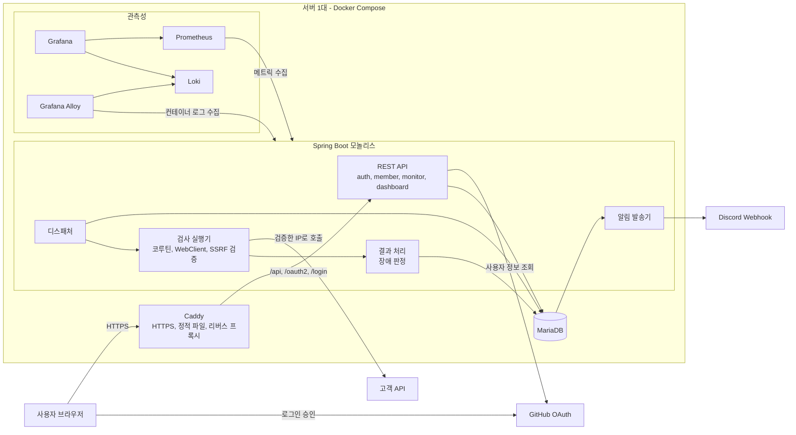
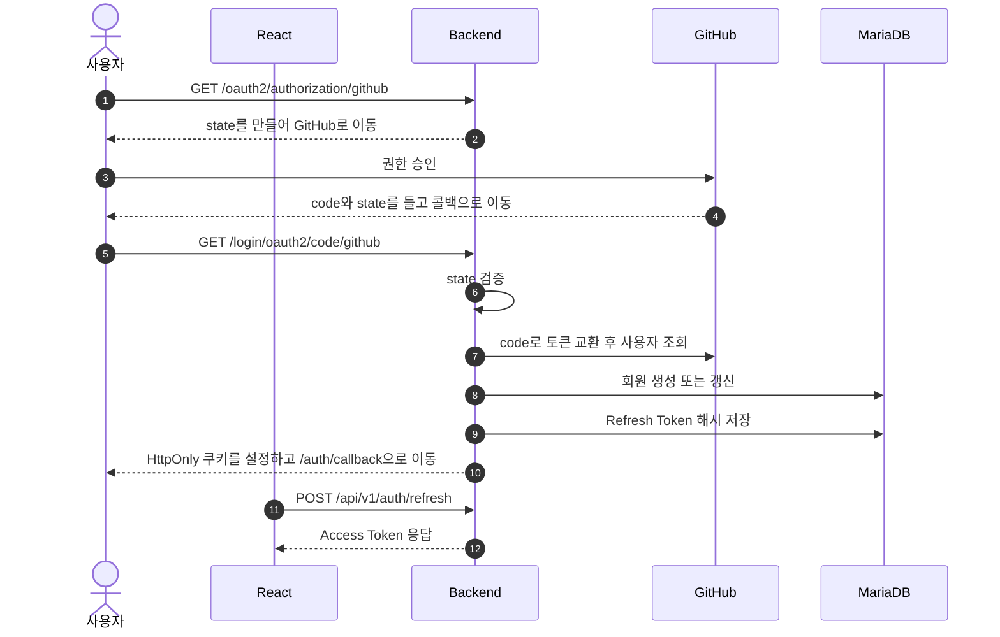
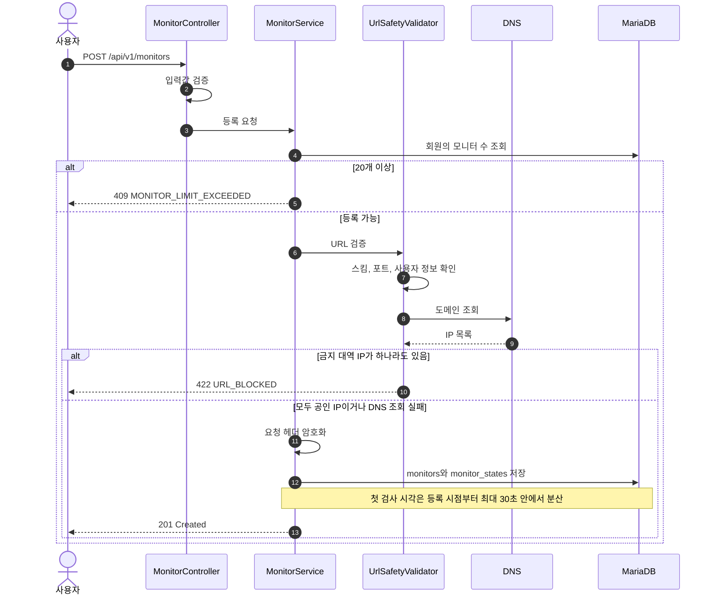
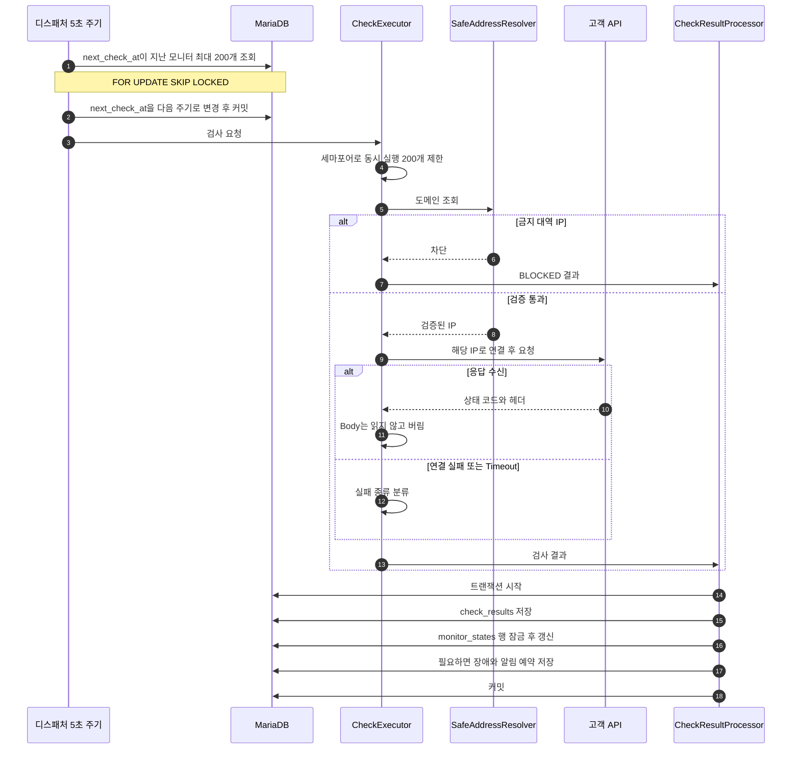
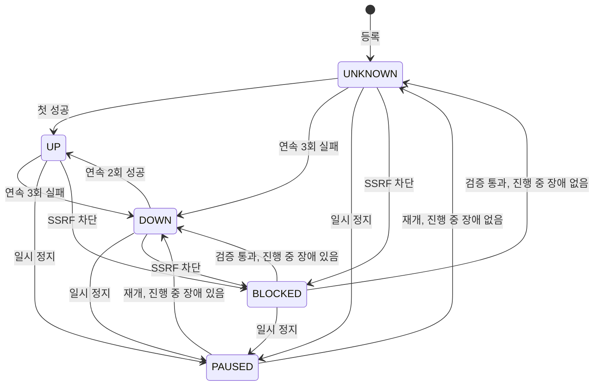
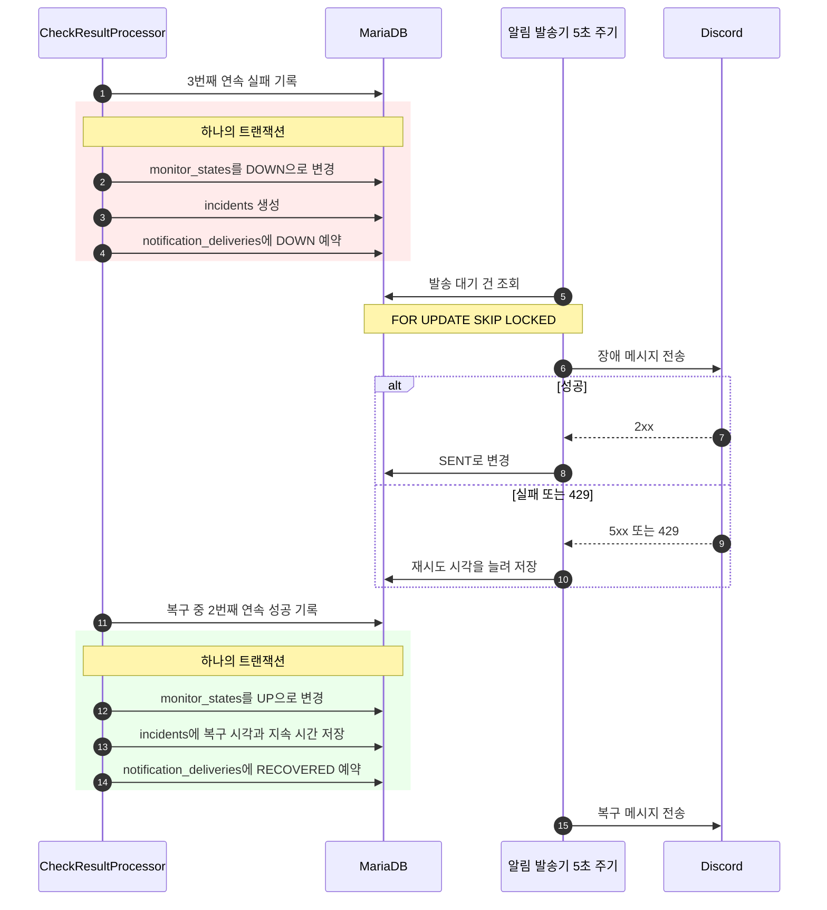
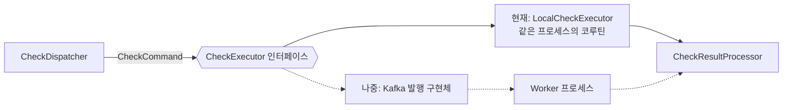

# 02. 시스템 아키텍처

> 상태: 확정 (2026-11-09).

## 1. 전체 구성도

| 구성 요소 | 역할 | 선택 이유 |
| --- | --- | --- |
| Caddy | HTTPS 인증서 자동 발급, React 정적 파일 제공, API 전달 | 화면과 API를 같은 도메인으로 묶어 CORS 설정과 쿠키 처리가 단순해진다 |
| Spring Boot | API, 스케줄링, 검사, 알림을 한 프로세스에서 실행 | 처음부터 나누면 배포와 장애 지점만 늘어난다 |
| MariaDB | 회원, 설정, 검사 기록, 장애, 알림 예약 저장 | `SKIP LOCKED`를 지원하며(10.6 이상), 날짜별 파티션으로 오래된 기록을 빠르게 지울 수 있다 |
| Prometheus, Grafana | 우리 서버 자체의 메트릭 수집과 시각화 | 고객 API 검사 이력과 섞지 않는다 |
| Alloy, Loki | 컨테이너 로그 수집과 검색 | 로그 수집은 `CLAUDE.md` 규칙에 따라 Alloy로 한다 |

**리버스 프록시**는 외부 요청을 먼저 받아 내부 서버로 전달하는 서버다. **CORS**는 다른 도메인의 페이지가 API를 호출할 때 브라우저가 적용하는 제한이다. **메트릭**은 요청 수, 메모리 사용량 같은 수치 데이터다.

`/actuator`는 Caddy를 통해 외부에 노출하지 않고 컨테이너 내부 네트워크에서만 접근한다.

## 2. 로그인 흐름

OAuth로 사용자를 확인한 뒤의 로그인 유지는 우리 서비스가 맡는다.

왜 이렇게 했는가

- **Access Token을 URL에 담지 않는다.** URL은 브라우저 기록과 서버 로그에 남는다.
- **`state`를 검증한다.** 공격자의 로그인 결과를 피해자 브라우저에 끼워 넣는 CSRF 공격을 막는다.
- **GitHub 토큰은 저장하지 않는다.** 사용자 확인에만 필요하며, 보관하면 유출 위험만 늘어난다.
- **Refresh Token은 JWT가 아닌 무작위 문자열로 만든다.** 어차피 DB에서 조회해야 하므로 서명이 필요 없다.
- **보안 설정은 두 갈래로 나눈다.** OAuth 진행 구간만 세션을 잠깐 쓰고, 일반 API는 Stateless로 처리한다. 서버를 여러 대로 늘리면 세션 공유가 필요하며, 이것이 Redis를 도입할 이유 중 하나다.

### 2.1 요청 인증

SmartFridge의 구조를 따른다. `JwtTokenProvider`가 Access Token을 만들고, `JwtTokenFilter`가 요청마다 검증해 `SecurityContext`에 사용자를 넣는다.

| 구성 요소 | 역할 |
| --- | --- |
| `JwtTokenProvider` | HS256으로 Access Token 서명. `subject`는 회원 ID, `role`은 `USER` 또는 `DEMO` |
| `JwtTokenFilter` | `UsernamePasswordAuthenticationFilter` 앞에서 Bearer 토큰을 검증하고 권한을 `ROLE_` 형식으로 설정 |
| `JwtAuthenticationHandler` | 인증 실패 시 401 응답 |
| `JwtAuthorizationHandler` | 권한 부족 시 403 응답. 데모 계정의 변경 요청은 `DEMO_READ_ONLY` |

`SecurityContext`는 현재 요청의 사용자 정보를 담아 두는 Spring Security의 저장 공간이다.

SmartFridge에서 다음을 보완한다.

| 보완 | 이유 |
| --- | --- |
| `OncePerRequestFilter`를 상속하고, 서블릿 필터로 자동 등록되지 않게 한다 | `@Component`인 필터는 Spring Boot가 일반 필터로도 등록해 한 요청에서 두 번 실행될 수 있다 |
| 토큰 오류의 종류를 요청 속성에 담아 401 핸들러로 전달한다 | 예외를 로그만 남기고 넘기면 만료(`AUTH_TOKEN_EXPIRED`)와 위조(`AUTH_TOKEN_INVALID`)를 구분할 수 없어 프론트엔드가 재발급 여부를 판단하지 못한다 |
| `Bearer ` 접두사를 확인한 뒤 토큰을 자른다 | 잘못된 헤더 형식을 정상 경로에서 거른다 |
| `subject`를 이메일 대신 회원 ID로 쓴다 | 이메일을 수집하지 않고, 변하지 않는 값이어야 한다 |
| 최신 `jjwt` API를 쓰고 서명 키를 공유한다 | 발급과 검증이 같은 키와 알고리즘을 쓰게 한다 |
| 만료된 토큰은 `error`가 아닌 낮은 로그 레벨로 남긴다 | 정상적으로 자주 일어나는 일이라 실제 오류가 묻힌다 |

CORS는 설정하지 않는다. 운영에서는 Caddy가 화면과 API를 같은 도메인으로 묶고, 개발 환경은 Vite 프록시를 쓴다.

### 2.2 Refresh Token 쿠키

Synco의 `CookieUtil` 구조를 따른다. 쿠키 생성과 삭제를 한 클래스에 모으고, 환경마다 달라지는 값은 설정으로 분리한다.

| 메서드 또는 설정 | 역할 |
| --- | --- |
| `createRefreshTokenCookie` | `ResponseCookie`로 `HttpOnly` 쿠키 생성 |
| `deleteRefreshTokenCookie` | 같은 속성에 `Max-Age=0`으로 쿠키 삭제 |
| `cookie.secure` | 로컬 `false`, 운영 `true` |
| `cookie.same-site` | `Lax` |
| `cookie.max-age` | Refresh Token 수명과 같은 14일 |

| 사용 위치 | 동작 |
| --- | --- |
| GitHub 로그인 성공 | 쿠키 설정 후 `/auth/callback`으로 이동 |
| `POST /api/v1/auth/refresh` | 교체된 새 토큰으로 쿠키 재설정 |
| `POST /api/v1/auth/logout` | 쿠키 삭제 |

Synco에서 다음을 바꾼다.

| 보완 | 이유 |
| --- | --- |
| `Path`를 `/`에서 `/api/v1/auth`로 제한 | 일반 API 요청에 Refresh Token이 함께 전송되지 않는다 |
| 재발급할 때도 쿠키를 다시 설정 | Refresh Token을 매번 교체하므로 브라우저의 값도 바뀌어야 한다 |

쿠키를 삭제할 때는 생성할 때와 `Path`가 같아야 브라우저가 지운다. 두 메서드가 같은 값을 쓰도록 경로를 상수로 둔다.

## 3. 모니터 등록과 URL 검증

왜 이렇게 했는가

- **IP가 하나라도 금지 대역이면 거부한다.** 공인 IP와 내부 IP를 섞어 돌려주는 우회를 막는다.
- **DNS 조회 실패는 등록을 허용한다.** 아직 배포 전이거나 일시 장애일 수 있고, 위험한 주소라는 근거가 없다. 실패는 검사 결과로 드러난다.
- **등록할 때만 검증하지 않는다.** DNS 응답은 언제든 바뀔 수 있으므로 검사 때마다 다시 검증한다.

## 4. 주기 검사와 장애 처리

### 4.1 검사 실행부터 결과 저장까지

왜 이렇게 했는가

- **실행 전에 `next_check_at`을 먼저 옮긴다.** 검사 중 서버가 죽어도 "실행 중" 표시가 남지 않는다. 그 회차는 건너뛰고 다음 주기에 정상 재개된다.
- **`SKIP LOCKED`를 처음부터 쓴다.** 다른 프로세스가 잠근 행을 건너뛰는 기능이다. 지금은 서버가 1대지만 비용이 거의 없고, 여러 대로 늘려도 같은 모니터를 중복 검사하지 않는다.
- **결과 처리는 모니터당 한 트랜잭션이다.** 기록, 상태, 장애, 알림 예약이 함께 저장되거나 함께 취소된다. 초당 약 17건이면 묶음 저장 없이도 충분하다.
- **코루틴과 JPA를 분리한다.** 네트워크 대기는 코루틴으로 처리하고, DB 저장은 제한된 스레드 풀로 넘긴다. JPA 트랜잭션은 스레드에 묶여 동작해 코루틴과 섞으면 찾기 어려운 버그가 생긴다.

**코루틴**은 적은 스레드로 많은 대기 작업을 처리하는 Kotlin 기능이다. **세마포어**는 동시에 실행할 수 있는 개수를 제한하는 장치다.

### 4.2 모니터 상태 변화

| 상황 | 다음 검사 시각 |
| --- | --- |
| 정상 (`UP`, 연속 실패 0회) | 설정 주기 뒤 |
| 판정 중 (연속 실패 1~2회, 또는 장애 중 연속 성공 1회) | 30초 뒤 |
| 장애 중 (`DOWN`, 계속 실패) | 설정 주기와 5분 중 짧은 쪽 |
| `PAUSED` | `next_check_at`을 비워 조회에서 제외 |
| `BLOCKED` | 설정 주기 뒤 재검증 |

- 재검사 예약은 검사가 끝난 뒤에 하므로, 같은 모니터의 검사가 겹치지 않는다. 1회차 실행 시점에 `next_check_at`이 최소 1분 뒤로 옮겨지고, Timeout 최대값은 30초이기 때문이다.
- 일시 정지 중에도 진행 중인 장애는 닫지 않는다. 재개하면 `DOWN`으로 돌아가고, 연속 2회 성공해야 닫는다.
- `BLOCKED`가 되어도 진행 중인 장애는 유지한다. 연속 카운터는 0으로 되돌리고, `BLOCKED` 기록은 가동률 계산에서 제외한다.

### 4.3 장애 판정부터 알림 발송, 복구까지

왜 이렇게 했는가

- **Outbox 패턴을 쓴다.** 장애 저장과 알림 발송을 함께 처리할 수는 없다. 그래서 "보낼 알림"을 장애와 같은 트랜잭션으로 DB에 적고, 발송기가 따로 보낸다. 서버가 죽어도 재시작 후 이어서 보낸다.
- **중복 방지를 DB 제약으로 건다.** 애플리케이션 코드에 버그가 있어도 진행 중 장애는 모니터당 하나, 알림 예약은 장애·채널·종류별로 하나만 생긴다.
- **재시도는 최대 5회로 제한한다.** 1분, 5분, 15분, 1시간 등으로 간격을 늘린다. 429 응답(요청 과다)이면 Discord가 알려 준 대기 시간을 지킨다.

알림 전송 후 DB 기록 전에 서버가 죽으면 같은 알림이 다시 발송될 수 있다. 알림을 잃는 것보다 드문 중복이 낫다고 판단했다.

## 5. Worker 분리와 Kafka 도입을 쉽게 하는 구조

현재는 하나의 프로세스지만 경계는 미리 나눈다.

| 원칙 | 효과 |
| --- | --- |
| `check`는 `monitor`의 JPA 엔티티를 직접 받지 않고, 필요한 값만 담은 `CheckCommand`를 받는다 | 네트워크로 전달할 수 있는 형태가 된다 |
| 검사 결과도 `CheckResult` 값 객체로 전달한다 | 결과 처리가 실행 위치를 몰라도 된다 |
| 호출부는 `CheckExecutor` 인터페이스에만 의존한다 | 구현체만 바꾸면 Worker로 이동한다 |
| 결과 처리는 같은 입력이 두 번 와도 안전하게 만든다 | Kafka의 중복 전달에 대비한다 |
| `monitors`(설정)와 `monitor_states`(실행 상태)를 나눈다 | 사용자의 설정 수정과 검사 상태 갱신이 서로 충돌하지 않는다 |

확장 지점은 이 인터페이스 하나만 둔다. 미리 Kafka 추상화를 여러 겹 만들지 않는다.

## 6. Redis와 Kafka 도입 기준

Redis는 16단계 뒤 부하 테스트 결과를 기준으로 해결할 문제를 정해 도입한다. Kafka는 배포 후에 Worker 분리를 학습하고 검증하는 목적으로 도입한다.

| 기술 | 도입 시점 | 해결할 문제 | 도입하지 않는 경우 |
| --- | --- | --- | --- |
| Redis | 17단계 | 대시보드 반복 조회의 DB 부하, IP별 요청 제한, 서버 증설 시 OAuth 세션 공유 | 위 문제가 측정되지 않으면 요청 제한부터 최소 범위로 적용 |
| Kafka | 18단계, 배포 후 | 검사 작업을 Worker 프로세스로 분리하고, 트래픽 급증을 완충하는 구조를 검증 | 목표 규모에서 필요하지 않아도 학습·포트폴리오 목적으로 진행한다 |

Kafka를 도입하면 위 구조의 `CheckExecutor` 구현체를 교체하고, Outbox 테이블을 발행 지점으로 재사용한다. Kafka 자체도 메모리를 많이 쓰는 서비스라 서버 1대 구성에서는 오히려 불안정해질 수 있다. README에는 목표 규모에서는 필요하지 않았다는 측정 결과와 학습 목적으로 도입한 이유를 함께 남긴다.

## 7. 운영 예외 처리

| 상황 | 처리 | 이유 |
| --- | --- | --- |
| 고객 API Timeout | `TIMEOUT` 결과로 기록 | 정상적인 실패 경로다 |
| DNS 조회 실패 | `DNS_ERROR`로 기록 | 도메인 설정 오류도 고객의 장애다 |
| 금지 대역 응답 | `BLOCKED`로 분리 | 고객 장애가 아닌 보안 이벤트다 |
| DB 일시 장애 | 디스패처는 로그를 남기고 다음 주기에 재시도. 결과 저장은 짧게 3회 재시도 후 포기하고 메트릭 증가 | 우리 장애를 고객 장애로 기록하면 안 된다 |
| 동시 실행 한도 초과 | 빈자리를 기다린다. 대기 시간은 디스패치 지연 메트릭으로 관측 | 한도를 넘겨 실행하면 서버가 먼저 죽는다 |
| 중복 실행 | `SKIP LOCKED`, 진행 중 장애 유니크 제약, 알림 유니크 제약 | 3중으로 막는다 |
| 서버 재시작 | 실행 중이던 회차는 버림. 알림 예약은 DB에 남아 이어서 처리 | "실행 중" 상태를 두지 않아 복구 로직이 필요 없다 |
| 파티션 작업 실패 | 메트릭과 로그로 알리고 다음 날 재시도. 미래 파티션을 3일치 미리 생성 | 하루 실패해도 저장이 멈추지 않는다 |

