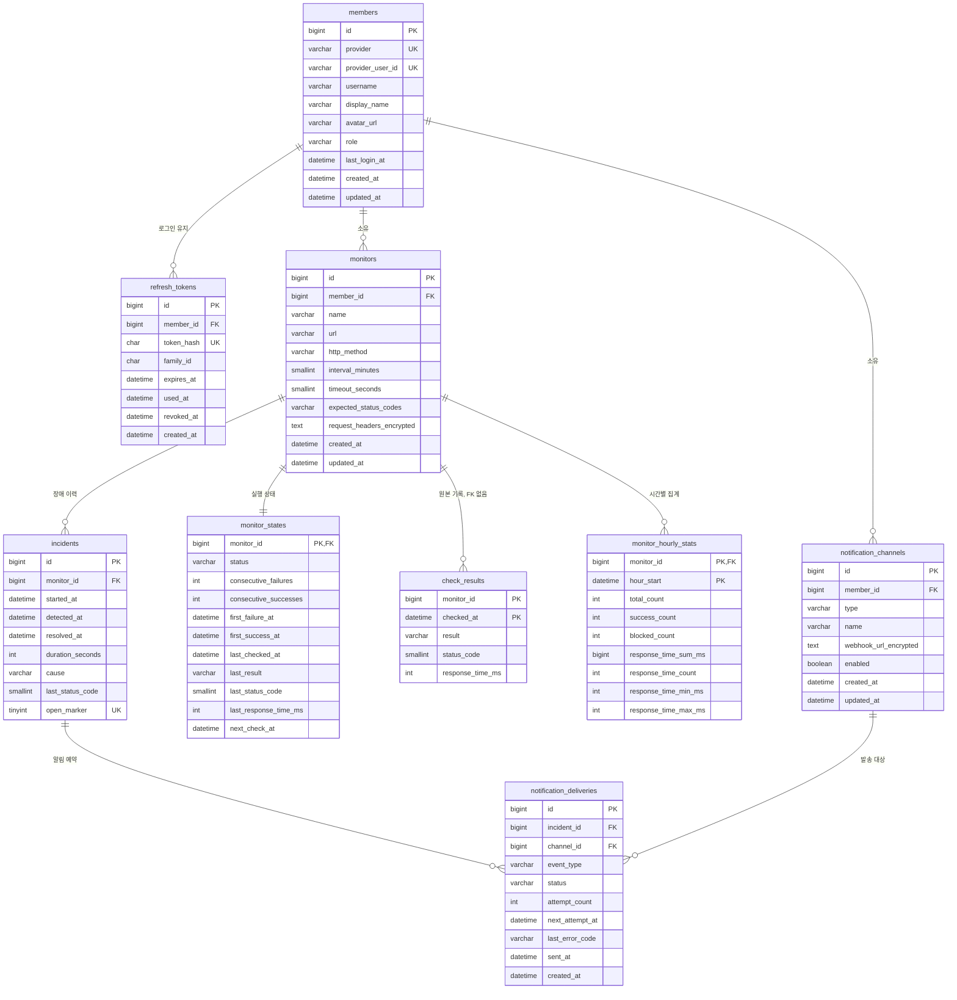

# 03. ERD

> 상태: 확정 (2026-11-09). 모든 시각은 UTC로 저장하고, 화면에서 사용자의 시간대로 변환한다.

**ERD**는 테이블과 테이블 사이의 관계를 그린 설계도다.

## 1. 전체 구조

## 2. 테이블 설계

공통 규칙

- `BIGINT` 기본 키를 쓴다. 검사 기록처럼 복합 키가 맞는 테이블만 예외다.
- 시각은 `DATETIME(3)`으로 밀리초까지 저장한다.
- 상태값은 DB의 ENUM 대신 `VARCHAR`로 저장한다. 값을 추가할 때 테이블 변경이 필요 없다.
- `member_id`, `monitor_id` 외래 키는 `ON DELETE CASCADE`로 만들어 회원과 모니터를 지우면 관련 데이터도 지운다. 단, `check_results`는 예외다.

**외래 키**(FK)는 다른 테이블의 행을 가리키는 값이고, 없는 행을 가리키지 못하게 DB가 막아 준다. **기본 키**(PK)는 행을 유일하게 구분하는 값이다. **인덱스**는 책의 색인처럼 조회를 빠르게 하는 구조로, 대신 쓰기가 조금 느려진다.

### 2.1 members

회원 정보. 비밀번호와 GitHub 토큰, 이메일은 저장하지 않는다. 알림이 Discord이므로 이메일이 필요 없고, 쓰지 않는 개인정보는 수집하지 않는다.

| 컬럼 | 타입 | 제약 | 설명 |
| --- | --- | --- | --- |
| id | BIGINT | PK, AUTO_INCREMENT | |
| provider | VARCHAR(20) | NOT NULL | `GITHUB`, 데모 계정은 `DEMO` |
| provider_user_id | VARCHAR(100) | NOT NULL | GitHub의 숫자 사용자 ID |
| username | VARCHAR(100) | NOT NULL | GitHub 로그인 이름 |
| display_name | VARCHAR(100) | NULL | 표시 이름 |
| avatar_url | VARCHAR(500) | NULL | 프로필 이미지 |
| role | VARCHAR(20) | NOT NULL | `USER`, `DEMO` |
| last_login_at | DATETIME(3) | NULL | |
| created_at, updated_at | DATETIME(3) | NOT NULL | |

인덱스: `UNIQUE (provider, provider_user_id)`

왜 이렇게 했는가: GitHub 사용자 이름은 바뀔 수 있으므로 변하지 않는 숫자 ID로 식별한다. 제공자까지 묶어서 유일하게 해야 나중에 Google을 추가해도 ID가 겹치지 않는다.

### 2.2 refresh_tokens

| 컬럼 | 타입 | 제약 | 설명 |
| --- | --- | --- | --- |
| id | BIGINT | PK | |
| member_id | BIGINT | FK, NOT NULL | |
| token_hash | CHAR(64) | UNIQUE, NOT NULL | 토큰의 SHA-256 해시 |
| family_id | CHAR(36) | NOT NULL | 같은 로그인에서 교체되어 온 토큰 묶음 |
| expires_at | DATETIME(3) | NOT NULL | |
| used_at | DATETIME(3) | NULL | 재발급에 사용된 시각 |
| revoked_at | DATETIME(3) | NULL | 로그아웃 또는 재사용 감지로 무효화된 시각 |
| created_at | DATETIME(3) | NOT NULL | |

인덱스: `(member_id)`, `(family_id)`, `(expires_at)`

왜 이렇게 했는가

- **해시로 저장한다.** DB가 유출되어도 토큰을 바로 쓸 수 없다.
- **`family_id`로 재사용을 감지한다.** 이미 사용된 토큰이 다시 오면 탈취로 보고 같은 묶음을 모두 무효화한다.
- 탭 두 개가 동시에 재발급을 요청하면 정상 사용자도 재사용으로 오인될 수 있다. `used_at`으로부터 10초 안의 재사용은 묶음을 무효화하지 않고 재발급만 거절한다.
- 기기별로 행이 생기므로 다른 기기의 로그인에 영향을 주지 않는다.
- 만료된 행은 하루 1번 삭제한다.

### 2.3 monitors

사용자가 입력한 설정.

| 컬럼 | 타입 | 제약 | 설명 |
| --- | --- | --- | --- |
| id | BIGINT | PK | |
| member_id | BIGINT | FK, NOT NULL | 소유자 |
| name | VARCHAR(100) | NOT NULL | |
| url | VARCHAR(2048) | NOT NULL | |
| http_method | VARCHAR(10) | NOT NULL | `GET`, `HEAD` |
| interval_minutes | SMALLINT | NOT NULL | 1, 5, 10, 30, 60 |
| timeout_seconds | SMALLINT | NOT NULL, 기본 10 | 1~30 |
| expected_status_codes | VARCHAR(50) | NULL | 쉼표로 구분, 예: `200,301`. NULL이면 2xx |
| request_headers_encrypted | TEXT | NULL | 암호화한 헤더 JSON. 최대 10개 |
| created_at, updated_at | DATETIME(3) | NOT NULL | |

인덱스: `(member_id)`

### 2.4 monitor_states

검사마다 갱신되는 실행 상태. 모니터와 1:1 관계다.

| 컬럼 | 타입 | 제약 | 설명 |
| --- | --- | --- | --- |
| monitor_id | BIGINT | PK, FK | |
| status | VARCHAR(20) | NOT NULL | `UNKNOWN`, `UP`, `DOWN`, `PAUSED`, `BLOCKED` |
| consecutive_failures | INT | NOT NULL, 기본 0 | |
| consecutive_successes | INT | NOT NULL, 기본 0 | |
| first_failure_at | DATETIME(3) | NULL | 연속 실패의 첫 시각. 장애 시작 시각이 된다 |
| first_success_at | DATETIME(3) | NULL | 연속 성공의 첫 시각. 복구 시각이 된다 |
| last_checked_at | DATETIME(3) | NULL | |
| last_result | VARCHAR(30) | NULL | |
| last_status_code | SMALLINT | NULL | |
| last_response_time_ms | INT | NULL | |
| next_check_at | DATETIME(3) | NULL | 비어 있으면 검사 대상이 아니다 |

인덱스: `(next_check_at)`

왜 이렇게 했는가

- **`monitors`와 나눈다.** 쓰기가 잦은 행과 사용자가 수정하는 행을 분리해 서로 잠금 경합을 일으키지 않게 한다.
- **대시보드가 원본 기록을 읽지 않아도 된다.** 현재 상태는 이 테이블만 보면 된다.

### 2.5 check_results

검사 원본 기록. 가장 빠르게 커지는 테이블이다.

| 컬럼 | 타입 | 제약 | 설명 |
| --- | --- | --- | --- |
| monitor_id | BIGINT | PK | FK 없음 |
| checked_at | DATETIME(3) | PK | 검사 시작 시각 |
| result | VARCHAR(30) | NOT NULL | `SUCCESS`, `TIMEOUT` 등 |
| status_code | SMALLINT | NULL | 응답을 받지 못하면 NULL |
| response_time_ms | INT | NULL | 응답을 받지 못하면 NULL |

## 3. 검사 결과의 인덱스와 보관 전략

| 설계 | 이유 |
| --- | --- |
| 기본 키 `(monitor_id, checked_at)` | 가장 많은 조회는 "이 모니터의 이 기간"이다. InnoDB는 기본 키 순서로 데이터를 저장하므로 추가 인덱스 없이 빠르다 |
| 별도 `id` 없음 | 쓰지 않는 값과 인덱스를 줄인다 |
| 날짜별 RANGE 파티션 `TO_DAYS(checked_at)` | 오래된 데이터를 `DELETE` 대신 파티션 삭제로 지운다 |
| 외래 키 없음 | MariaDB의 파티션 테이블은 외래 키를 지원하지 않는다 |

**파티션**은 하나의 테이블을 내부적으로 날짜별 구역으로 나누는 기능이다. 수천만 행을 `DELETE`하면 오래 걸리고 DB에 부담을 주지만, 파티션 하나를 지우는 작업은 거의 즉시 끝난다.

외래 키가 없어 생기는 문제는 다음과 같이 처리한다.

- 모니터를 지워도 해당 원본 기록은 보관 기간이 끝날 때까지 남는다.
- 모니터 ID는 재사용되지 않고, 조회는 소유자 검증을 먼저 거치므로 다른 사용자가 볼 수 없다.
- 보관 기간이 지나면 파티션과 함께 사라진다.

쓰기와 정리 작업

| 작업 | 주기 | 내용 |
| --- | --- | --- |
| 파티션 관리 | 매일 1회 | 앞으로 3일치 파티션을 미리 만들고, 보관 기간이 지난 파티션을 삭제한다 |
| 시간별 집계 | 매시 5분 | 직전 2시간을 모니터별로 다시 계산해 덮어쓴다 |

목표 규모(모니터 1,000개, 1분 주기, 14일 보관)에서 약 2천만 행이고, 데이터와 인덱스를 합쳐 수 GB가 될 것으로 예상한다. 실제 값은 부하 테스트에서 측정한다.

저장은 JPA 대신 `JdbcTemplate`으로 한다. 복합 키에 쓰기 전용이라 엔티티를 관리할 이유가 없다.

### 3.1 monitor_hourly_stats

| 컬럼 | 타입 | 제약 | 설명 |
| --- | --- | --- | --- |
| monitor_id | BIGINT | PK, FK | |
| hour_start | DATETIME | PK | 시간의 시작, 예: `14:00:00` |
| total_count | INT | NOT NULL | 전체 검사 수 |
| success_count | INT | NOT NULL | 성공 수 |
| blocked_count | INT | NOT NULL | SSRF 차단 수 |
| response_time_sum_ms | BIGINT | NOT NULL | 평균 계산용 합계 |
| response_time_count | INT | NOT NULL | 평균 계산용 건수 |
| response_time_min_ms, response_time_max_ms | INT | NULL | |

왜 이렇게 했는가

- **평균 대신 합계와 건수를 저장한다.** 평균끼리 다시 평균을 내면 값이 틀어진다. 합계와 건수는 시간을 일 단위로 묶어도 정확하다.
- **직전 2시간을 다시 계산한다.** 집계 시점에 늦게 저장된 기록을 반영하고, 작업을 여러 번 실행해도 결과가 같다.
- **가동률**은 `success_count / (total_count - blocked_count)`로 계산한다. 일시 정지 구간은 검사 자체가 없어 자연스럽게 제외된다.

365일이 지난 행은 하루 1번 삭제한다.

그래프 데이터 출처

| 기간 | 출처 | 간격 |
| --- | --- | --- |
| 24시간 | `check_results` | 5분 단위로 묶음 |
| 7일 | `monitor_hourly_stats` | 1시간 |
| 30일 | `monitor_hourly_stats` | 6시간 단위로 묶음 |

## 4. 장애 이력

### 4.1 incidents

| 컬럼 | 타입 | 제약 | 설명 |
| --- | --- | --- | --- |
| id | BIGINT | PK | |
| monitor_id | BIGINT | FK, NOT NULL | |
| started_at | DATETIME(3) | NOT NULL | 첫 번째 실패 시각 |
| detected_at | DATETIME(3) | NOT NULL | 장애로 판정한 시각 |
| resolved_at | DATETIME(3) | NULL | 복구 시각. NULL이면 진행 중 |
| duration_seconds | INT | NULL | 복구할 때 저장 |
| cause | VARCHAR(30) | NOT NULL | 판정 시점의 실패 종류 |
| last_status_code | SMALLINT | NULL | |
| open_marker | TINYINT | PERSISTENT 생성 컬럼 | 진행 중이면 1, 끝나면 NULL |

인덱스: `UNIQUE (monitor_id, open_marker)`, `(monitor_id, started_at)`

**지속 시간과 현재 장애 여부를 구하는 방법**

| 구하려는 값 | 방법 |
| --- | --- |
| 현재 장애 여부 | `resolved_at IS NULL`인 행이 있는지 확인 |
| 끝난 장애의 지속 시간 | 저장된 `duration_seconds` |
| 진행 중인 장애의 지속 시간 | 현재 시각 - `started_at` |
| 실제 장애 시작과 감지 지연 | `started_at`과 `detected_at`의 차이 |

왜 이렇게 했는가

- **장애 하나를 한 행으로 저장한다.** 시작과 복구를 별도 이벤트로 저장하면 짝을 맞춰야 해서 쿼리가 복잡해진다.
- **`started_at`은 첫 실패 시각이다.** 3번째 실패 시각을 쓰면 판정에 걸린 시간만큼 지속 시간이 짧게 기록된다.
- **`open_marker`로 진행 중 장애를 하나로 제한한다.** MariaDB에는 조건부 유니크 인덱스가 없다. 유니크 인덱스는 NULL끼리 중복을 허용하므로, 진행 중인 행만 1이 되게 하면 진행 중 장애는 모니터당 하나만 저장된다.

### 4.2 notification_channels

| 컬럼 | 타입 | 제약 | 설명 |
| --- | --- | --- | --- |
| id | BIGINT | PK | |
| member_id | BIGINT | FK, NOT NULL | 사용자당 최대 3개 |
| type | VARCHAR(20) | NOT NULL | `DISCORD` |
| name | VARCHAR(100) | NOT NULL | |
| webhook_url_encrypted | TEXT | NOT NULL | Webhook URL 자체가 비밀번호 역할을 하므로 암호화 |
| enabled | BOOLEAN | NOT NULL, 기본 true | |
| created_at, updated_at | DATETIME(3) | NOT NULL | |

인덱스: `(member_id)`

채널은 회원 단위로 관리해 모든 모니터의 알림을 받는다. 모니터별 채널 지정은 MVP에서 제외한다.

### 4.3 notification_deliveries

알림 예약 겸 발송 이력(Outbox).

| 컬럼 | 타입 | 제약 | 설명 |
| --- | --- | --- | --- |
| id | BIGINT | PK | |
| incident_id | BIGINT | FK, NOT NULL | |
| channel_id | BIGINT | FK, NOT NULL | |
| event_type | VARCHAR(20) | NOT NULL | `DOWN`, `RECOVERED` |
| status | VARCHAR(20) | NOT NULL | `PENDING`, `SENT`, `FAILED` |
| attempt_count | INT | NOT NULL, 기본 0 | |
| next_attempt_at | DATETIME(3) | NOT NULL | |
| last_error_code | VARCHAR(50) | NULL | 응답 본문이나 URL은 저장하지 않음 |
| sent_at | DATETIME(3) | NULL | |
| created_at | DATETIME(3) | NOT NULL | |

인덱스: `UNIQUE (incident_id, channel_id, event_type)`, `(status, next_attempt_at)`

왜 이렇게 했는가: 발송기가 행을 가져갈 때 `next_attempt_at`을 2분 뒤로 옮긴다. 발송 도중 서버가 죽어도 2분 뒤 다시 시도되므로 "발송 중" 상태가 필요 없다.

## 5. 민감 정보 보호

| 데이터 | 저장 방식 | 이유 |
| --- | --- | --- |
| Refresh Token | SHA-256 해시 | 비교만 하면 되므로 원문이 필요 없다 |
| 요청 헤더 값, Webhook URL | AES-GCM 암호화 | 실제 호출에 원문이 필요하다. JDK 기본 기능으로 구현하며 키는 환경 변수로 주입한다 |
| GitHub 토큰, 비밀번호 | 저장하지 않음 | |

**해시**는 원문으로 되돌릴 수 없는 변환이고, **암호화**는 키가 있으면 되돌릴 수 있는 변환이다.
