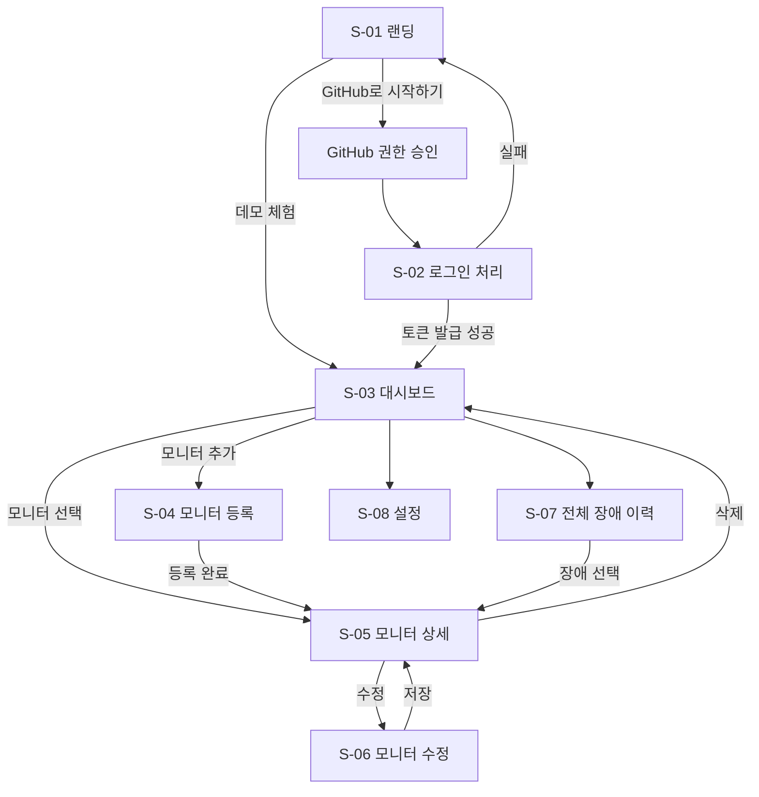

# 06. 화면 설계서

> 상태: 확정 (2026-11-09). 화면과 API의 연결은 [API 명세](./05-api-spec.md)를 따른다.

**와이어프레임**은 색과 디자인을 빼고 화면의 구성만 그린 설계도다. 아래 그림은 배치를 보여 주기 위한 것이며, 실제 스타일은 7단계와 14단계에서 정한다.

## 1. 화면 목록

| ID | 화면 | 경로 | 인증 | 파일 | 관련 요구사항 |
| --- | --- | --- | --- | --- | --- |
| S-01 | 랜딩 | `/` | 불필요 | `LandingPage` | F-M1, F-M3 |
| S-02 | 로그인 처리 | `/auth/callback` | 쿠키 | `AuthCallbackPage` | F-M1 |
| S-03 | 대시보드 | `/dashboard` | 필요 | `DashboardPage` | F-D1, F-D2 |
| S-04 | 모니터 등록 | `/monitors/new` | 필요 | `MonitorFormPage` | F-W1, F-W3, F-W4 |
| S-05 | 모니터 상세 | `/monitors/:id` | 필요 | `MonitorDetailPage` | F-W2, F-D3, F-D4 |
| S-06 | 모니터 수정 | `/monitors/:id/edit` | 필요 | `MonitorFormPage` | F-W2, F-W6 |
| S-07 | 전체 장애 이력 | `/incidents` | 필요 | `IncidentsPage` | F-D4 |
| S-08 | 설정 | `/settings` | 필요 | `SettingsPage` | F-N1, F-M2, F-M4 |

왜 이렇게 했는가: 등록과 수정은 입력 항목이 같으므로 파일 하나를 공유한다. 대시보드에 모든 정보를 넣지 않고 상세 화면으로 나누어, 접속했을 때 어떤 API에 문제가 있는지부터 보이게 한다.

## 2. 화면 흐름



## 3. 공통 요소

### 3.1 레이아웃

랜딩과 로그인 처리를 뺀 모든 화면에 적용한다.

```text
┌──────────────────────────────────────────────────────────┐
│ API Monitor   대시보드  장애 이력  설정       [프로필 ▾] │
├──────────────────────────────────────────────────────────┤
│ (데모 계정일 때만) 읽기 전용 체험 중입니다  [GitHub로 시작] │
├──────────────────────────────────────────────────────────┤
│                        화면 내용                         │
└──────────────────────────────────────────────────────────┘
```

프로필 메뉴에는 로그아웃과 모든 기기 로그아웃을 둔다.

### 3.2 모니터 상태 표시

색만으로 구분하지 않고 항상 글자를 함께 표시한다.

| 상태 | 표시 | 색 |
| --- | --- | --- |
| `UP` | 정상 | 초록 |
| `UP`이고 연속 실패 1~2회 | 확인 중 | 노랑 |
| `DOWN` | 장애 | 빨강 |
| `UNKNOWN` | 확인 전 | 회색 |
| `PAUSED` | 일시 정지 | 회색 |
| `BLOCKED` | 검사 차단 | 주황 |

### 3.3 공통 화면 상태

| 상태 | 처리 |
| --- | --- |
| 불러오는 중 | 내용 자리에 스켈레톤 표시 |
| 데이터 없음 | 안내 문구와 다음 행동 버튼 표시 |
| 서버 오류 | 오류 안내와 다시 시도 버튼, `traceId` 표시 |
| 네트워크 끊김 | 마지막으로 받은 데이터를 유지하고 상단에 안내 |
| 401 `AUTH_TOKEN_EXPIRED` | 자동으로 재발급 후 원래 요청 재시도 |
| 401 `AUTH_REFRESH_INVALID` | 랜딩으로 이동 |
| 404 | "찾을 수 없습니다" 화면 |

**스켈레톤**은 내용이 들어올 자리를 회색 틀로 먼저 보여 주는 로딩 표시다.

### 3.4 데모 계정

| 항목 | 처리 |
| --- | --- |
| 등록, 수정, 삭제, 정지 버튼 | 비활성화하고 "데모에서는 변경할 수 없습니다" 안내 |
| 알림 채널 관리 | 숨기고 안내 문구 표시 |
| 회원 탈퇴 | 숨김 |
| 서버의 403 `DEMO_READ_ONLY` | 화면에서 놓친 경우를 대비해 같은 안내 표시 |

버튼을 막아도 서버 검증은 그대로 유지한다. 화면의 제한은 사용 편의를 위한 것이고, 실제 보호는 서버가 맡는다.

## 4. 화면별 설계

### S-01 랜딩

```text
┌──────────────────────────────────────────────────────────┐
│ API Monitor                                              │
│                                                          │
│         내 API 장애를 사용자보다 먼저 알아채세요         │
│                                                          │
│        [GitHub로 시작하기]      [데모 체험하기]          │
│                                                          │
│   1분 주기 검사    장애·복구 Discord 알림    응답 시간 그래프 │
└──────────────────────────────────────────────────────────┘
```

| 동작 | API |
| --- | --- |
| GitHub로 시작하기 | `GET /oauth2/authorization/github` (페이지 이동) |
| 데모 체험하기 | `POST /api/v1/auth/demo` 후 `/dashboard` 이동 |

`/?loginError=true`로 돌아오면 "로그인에 실패했습니다. 다시 시도해 주세요."를 표시한다. 이미 로그인한 사용자는 `/dashboard`로 이동한다.

### S-02 로그인 처리

"로그인 중입니다" 문구만 표시한다.

| 동작 | API |
| --- | --- |
| 진입 즉시 Access Token 받기 | `POST /api/v1/auth/refresh` |
| 내 정보 조회 | `GET /api/v1/members/me` |

성공하면 `/dashboard`, 실패하면 `/?loginError=true`로 이동한다.

### S-03 대시보드

```text
┌──────────────────────────────────────────────────────────┐
│ 대시보드                                    [+ 모니터 추가] │
│ ┌────────┐ ┌────────┐ ┌────────┐ ┌────────┐             │
│ │전체 12 │ │정상 10 │ │장애  1 │ │24h 99.7%│             │
│ └────────┘ └────────┘ └────────┘ └────────┘             │
│                                                          │
│ 진행 중이거나 최근의 장애                                │
│  ● 결제 API   장애   12분째   TIMEOUT             [보기] │
│                                                          │
│ 모니터                                                   │
│  이름       상태    응답 시간  24시간 가동률  마지막 검사 │
│  결제 API   장애    -          98.20%         10초 전    │
│  회원 API   정상    124ms      100.00%        32초 전    │
└──────────────────────────────────────────────────────────┘
```

| 영역 | API | 비고 |
| --- | --- | --- |
| 요약 카드, 최근 장애 | `GET /api/v1/dashboard/summary` | 30초마다 갱신 |
| 모니터 목록 | `GET /api/v1/monitors` | 30초마다 갱신 |

| 조건 | 처리 |
| --- | --- |
| 모니터가 없음 | "첫 모니터를 등록해 보세요"와 등록 버튼 |
| 20개 등록됨 | 추가 버튼을 비활성화하고 "최대 20개까지 등록할 수 있습니다" 표시 |
| 알림 채널이 없음 | "알림 채널을 등록해야 장애 알림을 받을 수 있습니다" 표시. 채널 조회는 `GET /api/v1/notification-channels` |

정렬은 장애, 확인 중, 나머지 순으로 해서 문제가 있는 모니터가 맨 위에 오게 한다.

### S-04 모니터 등록, S-06 모니터 수정

```text
┌──────────────────────────────────────────────────────────┐
│ 모니터 등록                                              │
│ 이름 *              [ 결제 API                         ] │
│ URL *               [ https://api.example.com/health   ] │
│ 메서드              ( GET ▾ )                            │
│ 검사 주기 *         ( 1분 ▾ )                            │
│ Timeout(초)         [ 10 ]                               │
│ 기대 상태 코드      [ 비워 두면 2xx ]                    │
│ 요청 헤더           이름 [          ] 값 [        ] [+]  │
│                                     [취소]  [저장]       │
└──────────────────────────────────────────────────────────┘
```

| 동작 | API |
| --- | --- |
| 등록 | `POST /api/v1/monitors` |
| 수정 화면 진입 | `GET /api/v1/monitors/{id}` |
| 수정 | `PATCH /api/v1/monitors/{id}` |

| 응답 | 화면 처리 |
| --- | --- |
| 400 `VALIDATION_FAILED` | `details`를 해당 입력칸 아래에 표시 |
| 409 `MONITOR_LIMIT_EXCEEDED` | "모니터는 20개까지 등록할 수 있습니다" |
| 422 `URL_BLOCKED` | "검사할 수 없는 URL입니다. 공개된 주소인지 확인해 주세요." |
| 422 `HEADER_NOT_ALLOWED` | 해당 헤더 입력칸에 "지정할 수 없는 헤더입니다" |

수정 화면에서 요청 헤더 값은 비워 두고 표시한다. 저장할 때 헤더를 변경하지 않으면 `headers`를 보내지 않아 기존 값을 유지한다. 변경하려면 **헤더 다시 입력** 버튼으로 전체를 새로 입력한다.

왜 이렇게 했는가: 서버는 헤더 값을 가려서 내려 주기 때문에, 가려진 값을 다시 저장해 실제 토큰이 지워지는 사고를 막아야 한다.

### S-05 모니터 상세

```text
┌──────────────────────────────────────────────────────────┐
│ 결제 API   [장애]                  [일시 정지][수정][삭제] │
│ GET https://api.example.com/health · 1분 주기             │
│                                                          │
│ 가동률 99.86%   평균 응답 131ms   [24시간][7일][30일]    │
│ ┌──────────────────────────────────────────────────────┐ │
│ │               응답 시간 그래프                       │ │
│ └──────────────────────────────────────────────────────┘ │
│ 장애 이력                                                │
│  시작              지속 시간   원인        상태           │
│  11/09 20:00       20분        HTTP 503    복구           │
│ 최근 검사                                                │
│  시각              결과        상태 코드   응답 시간      │
│  20:45:00          성공        200         124ms          │
│                                      [더 보기]           │
└──────────────────────────────────────────────────────────┘
```

| 영역 | API | 비고 |
| --- | --- | --- |
| 기본 정보 | `GET /api/v1/monitors/{id}` | 30초마다 갱신 |
| 그래프, 가동률 | `GET /api/v1/monitors/{id}/stats?range=24h` | 기간 버튼으로 변경 |
| 장애 이력 | `GET /api/v1/monitors/{id}/incidents` | 커서 방식 |
| 최근 검사 | `GET /api/v1/monitors/{id}/checks` | 더 보기로 커서 방식 |
| 일시 정지, 재개 | `POST /api/v1/monitors/{id}/pause`, `/resume` | |
| 삭제 | `DELETE /api/v1/monitors/{id}` | 확인 창 후 실행 |

| 조건 | 처리 |
| --- | --- |
| `BLOCKED` | "안전하지 않은 주소로 연결되어 검사를 멈췄습니다" 안내 |
| 검사 기록 없음 | "첫 검사를 기다리는 중입니다" 표시 |
| 검사가 없던 구간 | 그래프를 이어 그리지 않고 끊어서 표시 |
| 삭제 확인 창 | 모니터 이름과 "장애 이력도 함께 삭제됩니다" 표시 |

### S-07 전체 장애 이력

```text
┌──────────────────────────────────────────────────────────┐
│ 장애 이력                 [전체] [진행 중] [복구]        │
│  모니터     상태     시작          지속 시간   원인       │
│  결제 API   진행 중  11/09 20:00   12분째      TIMEOUT    │
│  회원 API   복구     11/08 03:10   5분         HTTP 500   │
│                                    [더 보기]             │
└──────────────────────────────────────────────────────────┘
```

| 동작 | API |
| --- | --- |
| 목록, 필터, 더 보기 | `GET /api/v1/incidents?status=&cursor=` |
| 행 선택 | S-05로 이동 |

장애가 없으면 "기록된 장애가 없습니다"를 표시한다. 진행 중인 장애의 지속 시간은 화면에서 현재 시각과 `startedAt`의 차이로 계산한다.

### S-08 설정

```text
┌──────────────────────────────────────────────────────────┐
│ 알림 채널                                   [+ 채널 추가] │
│  운영 알림   Discord   ••••abcd   [켜짐]  [테스트][수정][삭제] │
│                                                          │
│ 계정                                                     │
│  octocat (GitHub)                                        │
│  [모든 기기 로그아웃]                       [회원 탈퇴]  │
└──────────────────────────────────────────────────────────┘
```

| 동작 | API |
| --- | --- |
| 채널 목록 | `GET /api/v1/notification-channels` |
| 채널 추가 | `POST /api/v1/notification-channels` |
| 수정, 켜기·끄기 | `PATCH /api/v1/notification-channels/{id}` |
| 삭제 | `DELETE /api/v1/notification-channels/{id}` |
| 테스트 발송 | `POST /api/v1/notification-channels/{id}/test` |
| 계정 정보 | `GET /api/v1/members/me` |
| 로그아웃 | `POST /api/v1/auth/logout` |
| 모든 기기 로그아웃 | `POST /api/v1/auth/logout-all` |
| 회원 탈퇴 | `DELETE /api/v1/members/me` |

| 응답 | 화면 처리 |
| --- | --- |
| 422 `WEBHOOK_URL_INVALID` | "Discord Webhook 주소를 입력해 주세요" |
| 409 `CHANNEL_LIMIT_EXCEEDED` | "알림 채널은 3개까지 등록할 수 있습니다" |
| 502 `NOTIFICATION_SEND_FAILED` | "테스트 메시지를 보내지 못했습니다. 주소를 확인해 주세요." |

회원 탈퇴는 확인 창에서 GitHub 사용자 이름을 입력해야 실행한다. 모니터와 장애 이력이 모두 삭제되어 되돌릴 수 없기 때문이다.

## 5. API 연결 점검

[API 명세](./05-api-spec.md)의 일반 API와 화면의 연결을 대조한 결과다.

| API 분류 | 사용 화면 |
| --- | --- |
| 인증 | S-01, S-02, 레이아웃 프로필 메뉴, S-08 |
| 회원 | S-02, S-08 |
| 모니터 | S-03, S-04, S-05, S-06 |
| 장애 | S-05, S-07 |
| 대시보드 | S-03 |
| 알림 채널 | S-03, S-08 |
